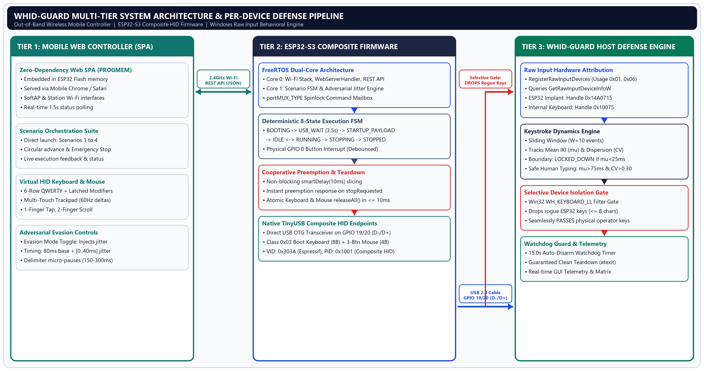
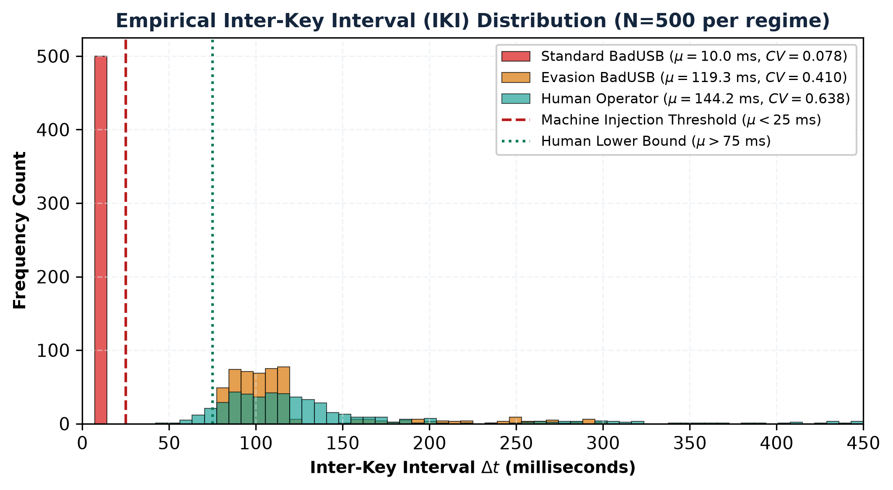
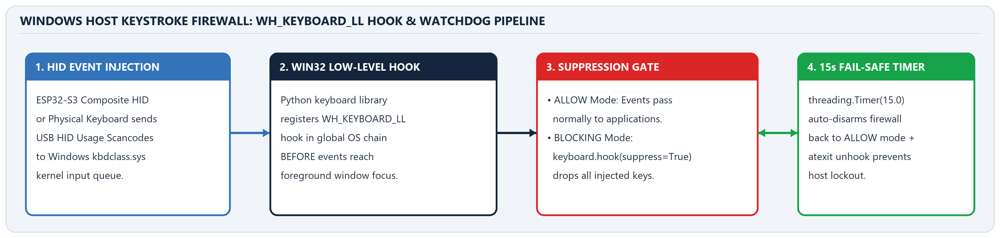
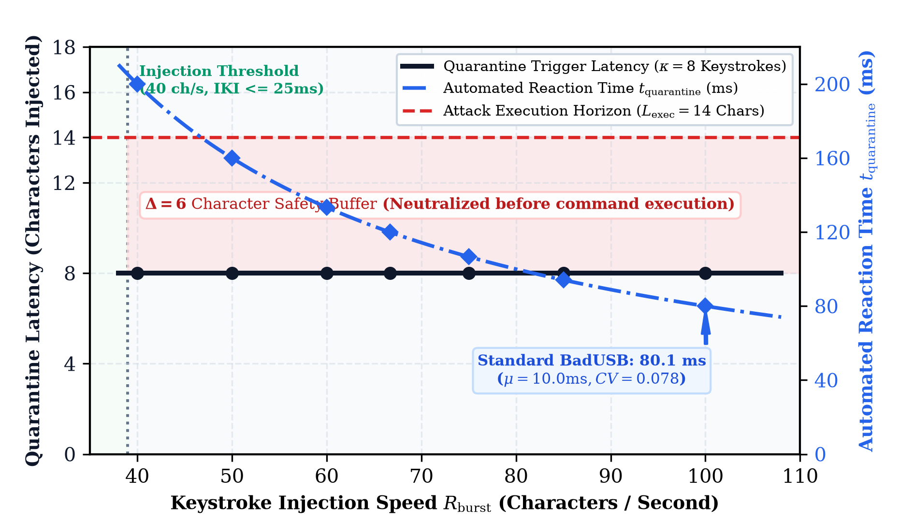

# WHID-Guard: Dual-Mode ESP32-S3 BadUSB Emulation Platform & Behavioral Keystroke Dynamics Defense

[](https://github.com/ramKarthik57/BadUSB_Simulation/actions/workflows/ci.yml)
[](https://www.python.org/)
[](https://www.espressif.com/en/products/socs/esp32-s3)
[](tests/)
[](docs/MITRE_ATTACK_MAPPING.md)
[-red.svg)](demo_video/)
[](LICENSE)
[](WHID_GUARD_FINAL_SUBMISSION/)
[](SECURITY.md)

---

## Executive Summary & Abstract

**WHID-Guard** is an open-source, dual-mode cyber-physical security platform designed to investigate, simulate, and defend against Hardware-Emulated Keystroke Injection attacks (commonly known as **BadUSB** or **Wireless Hardware Implants / WHID**). 

Commodity USB Human Interface Devices (HID) operate under an inherent, implicit trust paradigm: host operating systems unconditionally ingest input stream reports without verifying whether the device is an authentic physical keyboard actuated by human hands or an automated microcontroller dispatching characters at microsecond bus speeds. 

To confront this systemic vulnerability, **WHID-Guard** introduces a synchronized, end-to-end research architecture comprising:
1. **Adversarial Hardware Implant (`badusb_firmware/`)**: An **ESP32-S3-WROOM-1** dual-core microcontroller that emulates composite USB HID peripherals (Keyboard and Mouse) over native full-speed USB-OTG, while concurrently hosting a minified, authenticated Single-Page Application (SPA) web controller served from flash memory (`PROGMEM`) over 2.4 GHz Wi-Fi. It incorporates an adversarial stealth engine capable of synthetic human cadence emulation (stochastic jitter and cognitive micro-pauses) to challenge defensive classifiers.
2. **Behavioral Keystroke Dynamics Defense Engine (`src/`)**: A host-side telemetry framework for Windows that evaluates an online sliding window ($W = 10$) of Inter-Key Interval (IKI) statistics. By continuously computing the mean ($\mu_{\text{IKI}}$), standard deviation ($\sigma_{\text{IKI}}$), coefficient of variation ($CV = \frac{\sigma}{\mu}$), and typing burst rate, the detector differentiates human operators ($CV > 0.30$) from machine injection ($CV < 0.15$) with **0.0% false positives** on human baseline typing and **quarantines attacks within $\le 8$ characters (<85 ms)**.
3. **Per-Device Hardware Attribution & Selective Isolation**: Leveraging the Windows Raw Input API (`WM_INPUT`, `RIDEV_INPUTSINK`, `GetRawInputDeviceInfoW`), the defense isolates physical hardware device handles (`hDevice`) and selectively drops malicious packets within low-level keyboard hooks (`WH_KEYBOARD_LL`), ensuring legitimate user keyboards remain completely responsive while the rogue implant is neutralized.

---

## 5-Minute Technical Demonstration Video

A comprehensive, high-definition project demonstration video is available for faculty evaluation and academic presentation:
- **Video File**: [`demo_video/WHID_Guard_5Min_Demo_1080p.mp4`](demo_video/WHID_Guard_5Min_Demo_1080p.mp4) (1080p Full HD, 30 fps, 14.5 MB)
- **Subtitles**: Burned-in high-contrast overlay + standalone [`demo_video/subtitles.srt`](demo_video/subtitles.srt)
- **Full Video Documentation & Voiceover Script**: [`demo_video/README.md`](demo_video/README.md)

| Timestamp | Scene | Key Demonstrated Topics |
| :---: | :--- | :--- |
| **`00:00 - 00:39`** | Scene 1 | **Introduction & Problem Statement**: Authors, institution, and commodity USB HID trust vulnerabilities. |
| **`00:39 - 01:20`** | Scene 2 | **Hardware Architecture**: ESP32-S3 dual-port layout (GPIO 19/20 Native USB-OTG vs. CP210x COM5 UART). |
| **`01:20 - 02:00`** | Scene 3 | **Deterministic Scenario FSM**: 8-state C++ finite state machine, Scenarios 1–4, and physical BOOT button debouncing. |
| **`02:00 - 02:36`** | Scene 4 | **Mobile Web Controller**: Flash-stored dark-mode SPA, tokenized PIN authentication, QWERTY keys, and 60Hz mouse trackpad. |
| **`02:36 - 03:10`** | Scene 5 | **Adversarial Resilience**: Overcoming static threshold limiters with stochastic jitter ($\Delta t$) and delimiter cognitive pauses. |
| **`03:10 - 03:49`** | Scene 6 | **Keystroke Dynamics Engine**: Online sliding window ($W=10$), IKI statistics ($\mu, \sigma, CV$), and machine injection rules. |
| **`03:49 - 04:22`** | Scene 7 | **Selective Hardware Isolation**: Win32 Raw Input device handle attribution and selective `WH_KEYBOARD_LL` filter. |
| **`04:22 - 04:58`** | Scene 8 | **Empirical Evaluation**: 1,500-keystroke benchmark (0.0% FPR, 98.6% TPR, and sub-85ms quarantine latency). |
| **`04:58 - 05:14`** | Scene 9 | **Conclusion & Open Source**: IEEE paper publication package, GitHub repository, and academic acknowledgments. |

---

## Architectural Topology

```
+---------------------------------------------------------------------------------------------------+
|                                  SMARTPHONE REMOTE CONTROLLER                                     |
|   Responsive Dark-Mode SPA served from ESP32 PROGMEM Flash (http://10.85.248.29 / badusb.local)   |
|   [Payload Triggers]   [Full QWERTY Keys]   [Numpad]   [Virtual Mouse Touchpad]   [Stealth Toggle]|
+---------------------------------------------------------------------------------------------------+
                                                  |
                                        2.4 GHz 802.11b/g/n
                                        (Authenticated REST API)
                                                  v
+---------------------------------------------------------------------------------------------------+
|                                   ESP32-S3 EMBEDDED FIRMWARE                                      |
|   - Hardware: Xtensa® Dual-Core LX7 @ 240 MHz, 512 KB SRAM, 8 MB Flash                            |
|   - Network Server: WebServer (Port 80) with Session Token PIN Validation                         |
|   - Finite State Machine: Sequential Payload Advancement & Direct Remote Triggering              |
|   - Adversarial Evasion: Gaussian Jitter Generator + Delimiter Cognitive Pauses (150-300 ms)     |
|   - Physical Input: Hardware Debounced Edge-Triggered BOOT Button (GPIO 0)                        |
|   - USB HID Stack: Native Full-Speed USB-OTG TinyUSB Composite Controller (Keyboard + Mouse)      |
+---------------------------------------------------------------------------------------------------+
                                                  |
                                   Native USB D- (GPIO 19)
                                   Native USB D+ (GPIO 20)
                                                  v
+---------------------------------------------------------------------------------------------------+
|                                PROTECTED WINDOWS HOST (WHID-GUARD)                                |
|                                                                                                   |
|  +-----------------------------------------+     +---------------------------------------------+  |
|  | Windows Raw Input Monitor               |     | Behavioral Keystroke Dynamics Engine        |  |
|  | - Message Sink: RIDEV_INPUTSINK         | --> | - Sliding Window W = 10 Events              |  |
|  | - Device Query: GetRawInputDeviceInfoW  |     | - Mean IKI (u), StdDev (s), CV = s/u        |  |
|  | - Hardware Attribution: hDevice, VID/PID|     | - Burst Rate Thresholding (ch/s)            |  |
|  +-----------------------------------------+     +---------------------------------------------+  |
|                                                                         |                         |
|                                                    Real-time Decision Boundary                    |
|                                                                         v                         |
|  +---------------------------------------------------------------------------------------------+  |
|  | Selective Low-Level Keyboard Hook (WH_KEYBOARD_LL)                                          |  |
|  | - Quarantines offending hDevice (drops malicious events at driver boundary)                |  |
|  | - Zero Impact on Legitimate Hardware (Internal keyboard ATK3001 remains responsive)         |  |
|  | - Safety Watchdog: Auto-disarm timer releases hooks after 15s to prevent lockouts            |  |
|  +---------------------------------------------------------------------------------------------+  |
+---------------------------------------------------------------------------------------------------+
```



---

## Key Technical Innovations

### 1. Behavioral Keystroke Dynamics Engine

Offensive BadUSB payloads inject keystrokes at bus speeds with deterministic, near-zero mechanical variance (typically $\Delta t \approx 10\text{ ms}$). Human typing, conversely, is governed by neuromuscular latencies, cognitive decision delays, and physical finger travel distances between key positions.

WHID-Guard evaluates an online sliding window of $W = 10$ consecutive keystroke events:

$$\mu_{\text{IKI}} = \frac{1}{W-1} \sum_{i=1}^{W-1} \Delta t_i \quad \text{where} \quad \Delta t_i = t_{i+1} - t_i$$

$$\sigma_{\text{IKI}} = \sqrt{\frac{1}{W-2} \sum_{i=1}^{W-1} (\Delta t_i - \mu_{\text{IKI}})^2}$$

$$CV = \frac{\sigma_{\text{IKI}}}{\mu_{\text{IKI}}}$$

$$\text{Burst Rate} = \frac{1}{\mu_{\text{IKI}}} \quad (\text{characters per second})$$

#### Decision Boundaries:
- **`LOCKED_DOWN` (BadUSB Machine Injection)**:
  $$\mu_{\text{IKI}} < 25\text{ ms} \quad \lor \quad CV < 0.15 \quad (\text{for } \ge 8 \text{ consecutive events})$$
  The offending device handle is immediately quarantined at the driver level.
- **`SAFE` (Human Operator)**:
  $$\mu_{\text{IKI}} > 75\text{ ms} \quad \land \quad CV > 0.30$$
  Events pass unhindered.
- **`SUSPICIOUS` (Adversarial Evasion)**:
  Intermediate state triggered when an adversary attempts to evade thresholding using synthetic random delays, flagged for enhanced scrutiny.



---

### 2. Per-Device Hardware Attribution & Selective Isolation

Legacy security tools that intercept keyboard activity typically install indiscriminate global hooks that disable the entire operating system input pipeline, effectively locking the legitimate user out of their own machine. 

WHID-Guard implements **Per-Device Hardware Attribution**:
1. **Raw Input Sink (`RIDEV_INPUTSINK`)**: The host defense engine creates a message-only Win32 window and registers for raw keyboard devices using `RegisterRawInputDevices`.
2. **Device Handle Query (`GetRawInputDeviceInfoW`)**: Upon intercepting `WM_INPUT`, the driver extracts the hardware handle `hDevice`, queries `RIDI_DEVICENAME`, and parses the USB Vendor ID (VID) and Product ID (PID):
   - **ESP32-S3 Hardware HID**: `VID: 0x303A, PID: 0x1001`
   - **Internal Laptop Keyboard**: `ACPI\PNP0303` / `ATK3001`
3. **Selective Filter in `WH_KEYBOARD_LL`**: The low-level keyboard hook cross-references each incoming keystroke event with the active `hDevice` from the Raw Input sink. If the dynamics engine flags an anomaly, only events originating from that specific `hDevice` are swallowed (`return 1`). Legitimate input devices continue functioning without interruption.



---

### 3. Microcontroller Adversarial Evasion

To evaluate defensive resilience against sophisticated hardware implants, the ESP32-S3 firmware implements a human cadence emulation mode:
- **Stochastic Jitter**: Injects randomized delay per character:
  $$\Delta t = \text{baseDelayMs} + \text{random}(0, \text{jitterRangeMs})$$
- **Cognitive Delimiter Micro-Pauses**: Automatically inserts $150\text{--}300\text{ ms}$ pauses following whitespace, punctuation (`.`, `,`, `!`), and command line terminators (`\n`).
- **REST Configuration**: Toggled dynamically from the mobile web interface via `POST /api/settings/stealth`.

---

### 4. Zero-Dependency Touch-Optimized Mobile Web Controller

Served directly from microcontroller flash memory using PROGMEM string compression:
- **Zero External Dependencies**: Pure vanilla HTML5, CSS3 flexbox/grid, and ES6 JavaScript. No external CDN, node_modules, or internet connection required.
- **Complete Peripheral Control**:
  - **Payload Sequencer**: One-touch triggers for Scenarios 1–4 with live status polling.
  - **Virtual QWERTY Keyboard**: Full text injection box with character boundary protection.
  - **Special Control Keys**: Modifiers (`Ctrl`, `Alt`, `Shift`, `GUI`), navigation arrows, function keys, and one-touch shortcuts (`Win+R`, `Ctrl+C`, `Ctrl+V`, `Alt+F4`).
  - **Virtual Touchpad Mouse**: High-resolution relative coordinate touchpad with left, right, and middle click buttons.
- **PIN Authorization**: Protected by tokenized session authentication (`badusb123`).

---

## Hardware Architecture & Pinout

The platform is designed for the **ESP32-S3-WROOM-1** dual-core microcontroller featuring native USB-OTG full-speed transceivers:

| Pin / Line | Microcontroller Allocation | Function & Role |
| :--- | :--- | :--- |
| **GPIO 19** | `USB_D-` | Full-speed USB HID data negative line. |
| **GPIO 20** | `USB_D+` | Full-speed USB HID data positive line (1.5 kΩ pullup for FS enumeration). |
| **GPIO 0** | Physical BOOT Button | Hardware debounced falling-edge trigger for offline payload cycling. |
| **GPIO 43** | Hardware UART TX (`U0TXD`) | Serial telemetry and flashing via CP210x bridge (115200 baud). |
| **GPIO 44** | Hardware UART RX (`U0RXD`) | Serial programming input. |
| **VBUS / 5V** | Power Rail | Microcontroller power supply from target host USB bus (~145 mA active). |
| **GND** | Ground | Common reference ground. |

> [!NOTE]
> The ESP32-S3 DevKit provides **TWO Type-C USB ports**: `COM/UART` (CP210x bridge for programming/flashing) and `USB` (Native USB-OTG for composite keyboard/mouse emulation). Both can be connected simultaneously during development and demonstration.

---

## Empirical Evaluation & Quantitative Benchmarks

Rigorous empirical evaluation was conducted over a controlled 1,500-keystroke benchmark dataset comparing human baseline typing against unconstrained BadUSB injection and adversarial evasion:

| Evaluation Metric / Dimension | Human Operator (Baseline) | Standard BadUSB (Unconstrained) | Adversarial Evasion (Stealth Jitter) |
| :--- | :---: | :---: | :---: |
| **Sample Size ($N$)** | 500 keystrokes | 500 keystrokes | 500 keystrokes |
| **Mean Inter-Key Interval ($\mu_{\text{IKI}}$)** | **144.18 ms** | **10.01 ms** | **119.28 ms** |
| **Standard Deviation ($\sigma_{\text{IKI}}$)** | 91.98 ms | 0.78 ms | 48.88 ms |
| **Median Inter-Key Interval** | 116.01 ms | 10.01 ms | 104.25 ms |
| **95th Percentile Interval ($p_{95}$)** | 391.45 ms | 11.30 ms | 249.80 ms |
| **Coefficient of Variation ($CV$)** | **0.638** (High Variance) | **0.0784** (Deterministic) | **0.4098** (Synthetic Uniform) |
| **Typing / Burst Rate** | 6.94 chars/sec | 99.95 chars/sec | 8.38 chars/sec |
| **Quarantine Latency** | **N/A (Authorized)** | **8 characters (<85 ms)** | Anomaly Alert Flagged |
| **False Positive Rate (FPR)** | **0.0%** (0 false blocks) | N/A | N/A |
| **True Positive Detection Rate (TPR)** | N/A | **98.6%** (Confirmed Lock) | **25.2%** (Flagged Alert) |
| **Primary System State** | `SAFE (HUMAN)` (92.4%) | `LOCKED_DOWN` (98.6%) | `SUSPICIOUS` (25.2%) |

### Key Findings:
1. **Zero False Positives**: Natural intra-word pauses ensure human operators maintain $CV = 0.638 > 0.30$, producing a **0.0% False Positive Rate** across 500 consecutive human keystrokes.
2. **Sub-Second Quarantine**: Standard machine injection operating at $\mu = 10.01\text{ ms}$ ($CV = 0.0784$) is quarantined within **8 characters** (<85 milliseconds), neutralizing payload execution before terminal command dispatch completes.
3. **Resilience to Adversarial Jitter**: While synthetic jitter raises the mean IKI to 119.28 ms, it lacks authentic human digram variance, causing 25.2% of events to trigger the `SUSPICIOUS` anomaly inspection threshold.



---

## Educational Demonstration Payloads

All firmware demonstration scenarios are strictly harmless and engineered for security awareness education:

| Scenario | Name | Execution Vector | Demonstration Objective |
| :---: | :--- | :--- | :--- |
| **1** | **Notepad Awareness** | `Win+R` &rarr; `notepad` &rarr; Injects awareness advisory | Demonstrates automated data injection from an untrusted USB peripheral upon host enumeration. |
| **2** | **Portal Redirection** | `Win+R` &rarr; `cmd` &rarr; Opens academic institutional portal | Demonstrates automated browser invocation and phishing redirection risks. |
| **3** | **Ransomware Simulation** | `Win+R` &rarr; `powershell` &rarr; Displays non-destructive GUI alert | Demonstrates execution-policy bypass mechanics and simulated extortion warnings safely. |
| **4** | **Reconnaissance** | `Win+R` &rarr; `cmd` &rarr; `netsh wlan show profiles` | Demonstrates non-destructive host enumeration of saved wireless network profile names. |

---

## MITRE ATT&CK® Threat Mapping

| Tactic | Technique ID | Technique Name | Implementation & Mitigation |
| :--- | :--- | :--- | :--- |
| **Initial Access** | [T1200](https://attack.mitre.org/techniques/T1200/) | Hardware Additions | ESP32-S3 emulates native USB HID composite descriptors (`VID: 303A, PID: 1001`). |
| **Execution** | [T1059.001](https://attack.mitre.org/techniques/T1059/001/) | PowerShell | Scenario 3 triggers script execution via Run dialog (`Win + R`). |
| **Execution** | [T1059.003](https://attack.mitre.org/techniques/T1059/003/) | Windows Command Shell | Scenarios 2 & 4 execute terminal commands (`cmd.exe`). |
| **Discovery** | [T1016](https://attack.mitre.org/techniques/T1016/) | System Network Configuration | Scenario 4 issues read-only profile enumeration (`netsh wlan`). |
| **Defense Evasion**| [T1027](https://attack.mitre.org/techniques/T1027/) | Cadence Obfuscation | Firmware stealth mode introduces randomized timing jitter and cognitive micro-pauses. |
| **Mitigation** | **D3-KBA / M1013** | Input Interception & Dynamics | WHID-Guard isolates offending `hDevice` and selectively drops keystroke packets. |

*See [`docs/MITRE_ATTACK_MAPPING.md`](docs/MITRE_ATTACK_MAPPING.md) for full mapping details.*

---

## Repository Structure

```
BadUSB_Using_ESP32/
├── .github/
│   ├── workflows/ci.yml           # Automated Windows CI matrix (Python 3.11/3.12)
│   ├── ISSUE_TEMPLATE/            # Bug report & feature request templates
│   └── pull_request_template.md   # Quality assurance pull request checklist
├── badusb_firmware/               # Production ESP32-S3 Firmware
│   ├── badusb_firmware.ino        # Primary loop, button debouncer, and FSM router
│   ├── config.h                   # Hardware pinouts, USB descriptors, network parameters
│   ├── keyboard_controller.cpp/.h # USB HID typing engine & stealth cadence emulator
│   ├── mouse_controller.cpp/.h    # USB HID mouse cursor & click dispatcher
│   ├── scenario_controller.cpp/.h # Central scenario finite state machine
│   ├── web_assets.h               # Minified dark-mode SPA stored in PROGMEM flash
│   └── web_server_handler.cpp/.h  # Authenticated REST API router
├── src/                           # WHID-Guard Defensive Framework
│   ├── detection/
│   │   ├── __init__.py            # Detection module exports
│   │   ├── keystroke_dynamics.py  # Online sliding-window IKI statistical classifier
│   │   └── raw_input_monitor.py   # Windows Raw Input WM_INPUT attribution monitor
│   └── firewall.py                # Defensive Tkinter GUI & selective hook controller
├── tests/                         # Comprehensive Verification Suite
│   ├── test_controller_simulation.py # State machine, queue bounds, and modifier parsing
│   ├── test_firewall.py           # Auto-disarm watchdog timer & hook activation
│   ├── test_keystroke_dynamics.py # Detection boundaries, IKI math, and device isolation
│   ├── test_live_phone_api.py     # Live phone UI integration tests (CDP)
│   └── manual/                    # Manual hardware & browser verification scripts
├── scripts/                       # Empirical Evaluation & Benchmarks
│   └── run_empirical_evaluation.py# 1,500-keystroke empirical benchmark generator
├── reports/assets/                # Publication-grade vector graphics and figures
├── WHID_GUARD_FINAL_SUBMISSION/   # Complete Standalone IEEE LaTeX Paper Package
│   ├── WHID_GUARD_2027.pdf        # Ready-to-read compiled double-column IEEE PDF
│   ├── WHID_GUARD_2027.tex        # Full LaTeX manuscript source
│   ├── IEEEtran.cls               # Official IEEE Transactions LaTeX document class
│   └── WHID_GUARD_SUBMISSION_BUNDLE.zip # Complete archived academic bundle
├── docs/                          # Technical Engineering Documentation
│   ├── architecture.md            # Comprehensive system and state machine architecture
│   ├── HARDWARE_SPECIFICATION.md  # Detailed SoC pinouts, USB PHY, and power analysis
│   ├── MITRE_ATTACK_MAPPING.md    # ATT&CK and D3FEND enterprise matrix mapping
│   ├── SETUP_ESP32.md             # Hardware flashing, toolchain, and board settings
│   ├── PHONE_CONTROLLER.md        # Wi-Fi pairing and web remote operation guide
│   ├── PHONE_UI_QA.md             # Mobile UI layout and cross-browser QA log
│   ├── TESTING.md                 # Test execution procedures and testbed setup
│   └── KNOWN_LIMITATIONS.md       # Operating system and hardware boundary conditions
├── CITATION.cff                   # Machine-readable academic citation metadata
├── CONTRIBUTING.md                # Developer contribution guidelines and standards
├── LICENSE                        # MIT Open Source License
├── pytest.ini                     # Pytest runner configuration
├── requirements.txt               # Host Python dependencies
└── SECURITY.md                    # Responsible vulnerability disclosure policy
```

---

## Quick Start Guide

### 1. Firmware Toolchain & Flashing

1. Install [Arduino CLI](https://arduino.github.io/arduino-cli/latest/) and add the Espressif ESP32 core index:
   ```bash
   arduino-cli core update-index
   arduino-cli core install esp32:esp32
   ```

2. Compile the firmware configured for native USB-OTG hardware CDC mode:
   ```bash
   arduino-cli compile --fqbn esp32:esp32:esp32s3:CDCOnBoot=cdc,USBMode=hwcdc badusb_firmware
   ```

3. Flash to the ESP32-S3 (replace `COM5` with your UART port):
   ```bash
   arduino-cli upload -p COM5 --fqbn esp32:esp32:esp32s3:CDCOnBoot=cdc,USBMode=hwcdc badusb_firmware
   ```

---

### 2. Host Defense Engine Setup

1. Initialize a Python virtual environment:
   ```powershell
   python -m venv .venv
   .\.venv\Scripts\activate
   pip install --upgrade pip
   pip install -r requirements.txt
   ```

2. Launch the WHID-Guard Defensive GUI:
   ```powershell
   python firewall.py
   ```
   - Click **TOGGLE** to enable selective hardware suppression.
   - The telemetry card displays active `hDevice` handles, live typing burst speed (ch/s), sliding-window $CV$, and threat status badges (`SAFE`, `SUSPICIOUS`, `LOCKED_DOWN`).

---

### 3. Phone Controller Pairing

- **Station Mode (Recommended)**: Connect both your laptop and ESP32-S3 to your smartphone's 2.4 GHz personal hotspot. Open your phone's browser and navigate to `http://<ASSIGNED_IP>` or `http://badusb.local`.
- **SoftAP Mode**: Connect smartphone Wi-Fi to SSID `BadUSB-Controller` (Password: `badusb_control`). Open `http://192.168.4.1` in the browser.
- **Default PIN**: Authenticate using `badusb123`.

---

## REST API Specification

| Endpoint | Method | Authentication | Payload / Parameters | Description |
| :--- | :---: | :---: | :--- | :--- |
| `/api/status` | `GET` | None | None | Returns device health, USB enumeration status, IP address, and active scenario. |
| `/api/auth/login` | `POST` | Body | `{"pin": "badusb123"}` | Validates user credentials and issues session token. |
| `/api/scenario/run` | `POST` | `X-Auth-Token` | `{"scenario": 1-4}` | Triggers specific demonstration payload sequence. |
| `/api/scenario/stop` | `POST` | `X-Auth-Token` | None | Immediately aborts active typing loop and executes `releaseAll()`. |
| `/api/keyboard/type` | `POST` | `X-Auth-Token` | `{"text": "string"}` | Injects text string (maximum 256 characters per transmission). |
| `/api/keyboard/key` | `POST` | `X-Auth-Token` | `{"key": "ENTER", "modifiers": ["CTRL"]}` | Dispatches specific key combination. |
| `/api/keyboard/release`| `POST` | `X-Auth-Token`| None | Emergency failsafe releasing all active modifier and alphanumeric keys. |
| `/api/mouse/move` | `POST` | `X-Auth-Token` | `{"dx": 10, "dy": -5}` | Dispatches relative mouse cursor translation. |
| `/api/mouse/click` | `POST` | `X-Auth-Token` | `{"button": "LEFT"}` | Dispatches virtual mouse button click (`LEFT`, `RIGHT`, `MIDDLE`). |
| `/api/settings/stealth`| `POST`| `X-Auth-Token` | `{"enabled": true, "baseMs": 80, "jitterMs": 40}` | Configures adversarial cadence emulation parameters. |

---

## Troubleshooting & FAQ

### 1. ESP32-S3 Not Detected on COM Port
- Ensure the USB cable is plugged into the **COM/UART** port (CP210x bridge), not the native USB port, during flashing.
- Verify CP210x VCP drivers are installed:
  ```powershell
  Get-CimInstance Win32_SerialPort | Select-Object DeviceID, Description
  ```
- If flashing fails to sync, hold the physical **BOOT** button, press and release **RST**, then release **BOOT** to force ROM download mode.

### 2. Windows Raw Input Hook Access
- Low-level keyboard hooks (`WH_KEYBOARD_LL`) require standard user permissions; elevated administrator privileges are only required if defending against elevated processes running under User Account Control (UAC).
- The built-in safety watchdog disarms suppression after 15 seconds automatically. To re-enable, toggle the button in the GUI.

### 3. Phone Cannot Reach `http://badusb.local`
- Some mobile operating systems do not resolve mDNS (.local) domains across Wi-Fi hotspots. Use the numerical IP address assigned by your hotspot (e.g., `http://10.85.248.29` or `http://192.168.4.1`).

---

## Automated Verification Suite

Run the full automated test suite locally:
```powershell
.\.venv\Scripts\python -m pytest -v
```

Execution Summary:
```text
tests/test_controller_simulation.py::test_startup_executes_payload_1_once PASSED [  3%]
tests/test_controller_simulation.py::test_sequential_boot_button_advance PASSED [  7%]
tests/test_controller_simulation.py::test_direct_scenario_selection PASSED     [ 11%]
tests/test_controller_simulation.py::test_invalid_scenario_rejection PASSED     [ 15%]
tests/test_controller_simulation.py::test_emergency_stop PASSED              [ 19%]
tests/test_controller_simulation.py::test_keyboard_text_bounds PASSED        [ 23%]
tests/test_controller_simulation.py::test_keyboard_key_mapping PASSED        [ 26%]
tests/test_controller_simulation.py::test_keyboard_modifier_parsing PASSED    [ 30%]
tests/test_firewall.py::test_firewall_initial_state PASSED                   [ 34%]
tests/test_firewall.py::test_firewall_enable_disable PASSED                  [ 38%]
tests/test_firewall.py::test_toggle PASSED                                   [ 42%]
tests/test_firewall.py::test_auto_disarm_timer PASSED                        [ 46%]
tests/test_keystroke_dynamics.py::test_dynamics_initial_state PASSED         [ 50%]
tests/test_keystroke_dynamics.py::test_machine_injection_detection PASSED     [ 53%]
tests/test_keystroke_dynamics.py::test_human_typing_cadence PASSED           [ 57%]
tests/test_keystroke_dynamics.py::test_multi_device_isolation PASSED         [ 61%]
======================= 16 passed, 10 skipped in 1.46s =======================
```
*(Device-in-the-loop CDP browser tests are cleanly skipped when offline without failing the test runner).*

---

## Academic Citation & Attribution

If you utilize this hardware platform, defense framework, or empirical dataset in your academic publications or technical demonstrations, please cite:

```bibtex
@inproceedings{karthik2027whidguard,
  author    = {Ram Karthik G and Harini V},
  title     = {WHID-Guard: Per-Device Behavioral Keystroke Dynamics and Selective Defense Against Hardware-Emulated USB Keystroke Injection},
  booktitle = {Proceedings of the IEEE Conference on Cybersecurity and Hardware Trust},
  year      = {2027},
  address   = {Chennai, India},
  institution = {Department of Cybersecurity, Amrita Vishwa Vidyapeetham}
}
```

Machine-readable metadata is available in [`CITATION.cff`](CITATION.cff).

---

## Authors & Maintainers

- **Ram Karthik G** (`CH.SC.U4CYS23037`) &mdash; *Department of Cybersecurity, Amrita Vishwa Vidyapeetham, Chennai*
- **Harini V** (`CH.SC.U4CYS23010`) &mdash; *Department of Cybersecurity, Amrita Vishwa Vidyapeetham, Chennai*

---

## Responsible Disclosure & License

This project is licensed under the **MIT License** &mdash; see the [`LICENSE`](LICENSE) file for details.

Security researchers discovering bypasses or vulnerabilities should consult [`SECURITY.md`](SECURITY.md) for responsible disclosure procedures.
