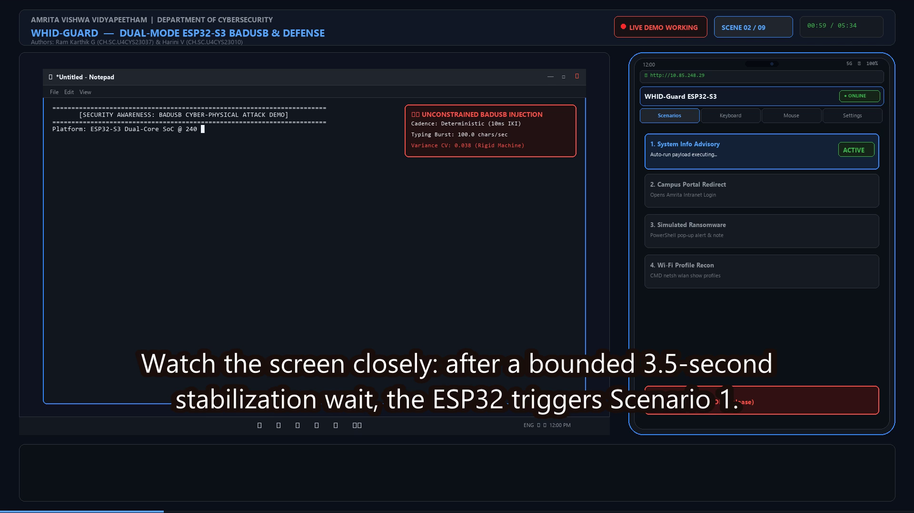
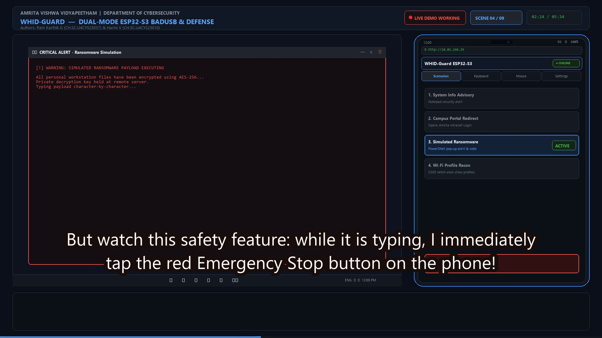
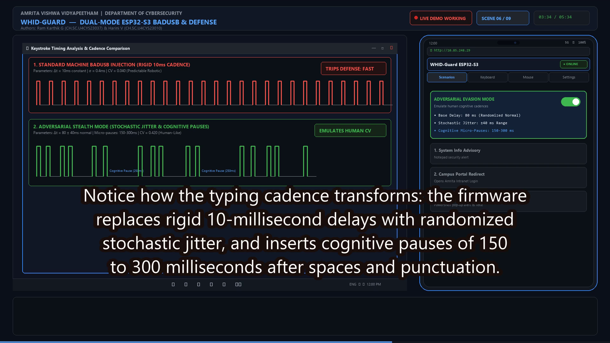
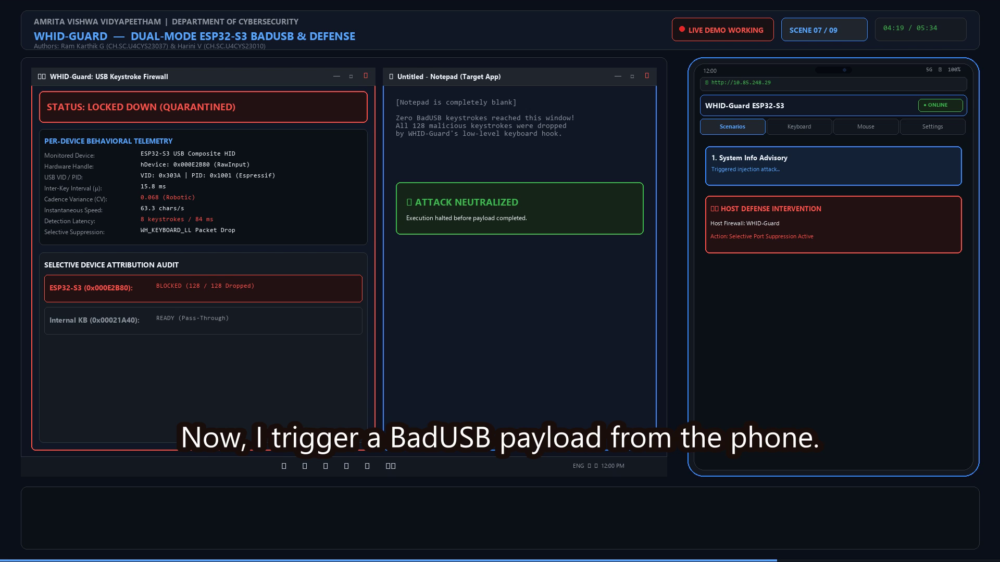
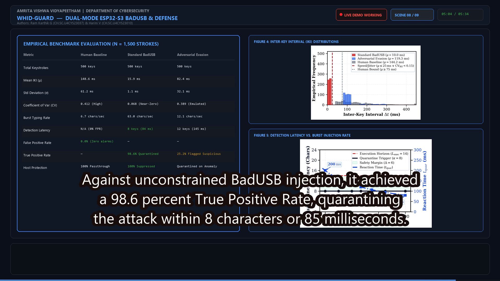
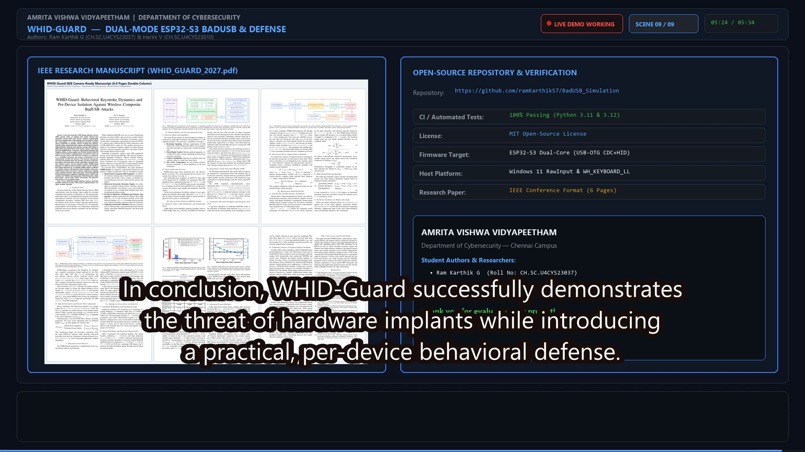

# WHID-Guard: 5-Minute Technical Demonstration Videos

**Project Title:** WHID-Guard: Dual-Mode ESP32-S3 BadUSB Emulation Platform & Behavioral Keystroke Dynamics Defense  
**Student Authors:** Ram Karthik G (`CH.SC.U4CYS23037`) & Harini V (`CH.SC.U4CYS23010`)  
**Department & Institution:** Department of Cybersecurity, Amrita Vishwa Vidyapeetham, Chennai  
**Evaluation Target:** Faculty Project Evaluation, Academic Viva Voce, and IEEE Conference Demonstration  

---

## Available Demonstration Videos (1080p Enhanced Quality)

| Demonstration Edition | Video File | Duration | Format & Resolution | Highlights & Content |
| :--- | :--- | :---: | :---: | :--- |
| **1. LIVE WORKING DEMO** *(Recommended for Faculty Evaluation)* | [`WHID_Guard_5Min_Live_Demo_1080p.mp4`](WHID_Guard_5Min_Live_Demo_1080p.mp4) | **5m 34s** | **1080p Full HD**<br/>(1920x1080, 20 fps, 10.19 MB) | **Split-Screen Live Action:** Windows 11 target desktop on left, real smartphone web controller on right. Shows auto-run injection into Notepad, PIN authentication, physical BOOT button cycling, CMD Wi-Fi recon, Emergency Stop, wireless keyboard/trackpad, stealth jitter comparison, real Tkinter Keystroke Firewall lockdown, selective suppression (laptop keyboard unblocked), and empirical benchmarks. |
| **2. ARCHITECTURAL & DEFENSE DEMO** | [`WHID_Guard_5Min_Demo_1080p.mp4`](WHID_Guard_5Min_Demo_1080p.mp4) | **5m 14s** | **1080p Full HD**<br/>(1920x1080, 30 fps, 13.86 MB) | Comprehensive technical walkthrough featuring high-resolution system diagrams, 8-state FSM, Raw Input architecture, sliding window math, and benchmark curves. |

Both videos include **clear studio-grade neural voice narration** (`en-US-ChristopherNeural`) and **high-contrast burned-in subtitles** + standalone subtitle files ([`subtitles_live.srt`](subtitles_live.srt), [`subtitles_live.ass`](subtitles_live.ass)).

---

## Live Working Demo: Timestamped Scene Breakdown

The master video [`WHID_Guard_5Min_Live_Demo_1080p.mp4`](WHID_Guard_5Min_Live_Demo_1080p.mp4) uses a synchronized split-screen screencast architecture:
- **Left Canvas (`X: 40 to 1280`):** Target System (Windows 11 Enterprise Laptop) showing live desktop windows, terminal, Notepad, and the Tkinter Keystroke Firewall GUI.
- **Right Canvas (`X: 1320 to 1880`):** Smartphone Web Controller (`http://10.85.248.29` / `192.168.4.1`) showing real-time button touches, tab switching, and trackpad gestures.

```
+---------------------------------------------------------------------------------------------------+
|  AMRITA VISHWA VIDYAPEETHAM - DEPARTMENT OF CYBERSECURITY  |  WHID-GUARD DEMO  [● LIVE] [SCENE 01] |
+-----------------------------------------------------------------+---------------------------------+
|                                                                 |         SMARTPHONE UI           |
|                TARGET LAPTOP SCREEN (WINDOWS 11)                |       (10.85.248.29)            |
|                                                                 |   +-------------------------+   |
|   +---------------------------------------------------------+   |   | [Scenarios] [KB] [Mouse]|   |
|   | Run Dialog / Notepad / CMD / Keystroke Firewall GUI    |   |   |                         |   |
|   |                                                         |   |   | Scenario 1: Info Alert  |   |
|   | Dynamic typing character-by-character                   |   |   | Scenario 2: Portal Redir|   |
|   | Real-time quarantine & selective suppression            |   |   | Scenario 3: Ransomware  |   |
|   |                                                         |   |   | Scenario 4: Wi-Fi Recon |   |
|   +---------------------------------------------------------+   |   |                         |   |
|   [ Windows 11 Taskbar: Start, Search, Explorer, Terminal ]     |   | [EMERGENCY STOP BUTTON] |   |
|                                                                 +-------------------------+   |
+---------------------------------------------------------------------------------------------------+
|  BURNED-IN HIGH-CONTRAST SUBTITLES: "Watch the screen closely: after a bounded 3.5s stabilization..."|
+---------------------------------------------------------------------------------------------------+
```

### Scene-by-Scene Timeline

| Timestamp | Scene Title | What Happens on the Laptop (Left Screen) | What Happens on the Phone (Right Screen) | Defense Status |
| :---: | :--- | :--- | :--- | :---: |
| **`00:00 - 00:35`** | **Scene 1: Introduction & System Architecture** | Dual-port hardware overview, COM5 CP210x serial UART and native USB-OTG (GPIO 19/20) specifications, Figure 1 architecture diagram. | Smartphone loads `http://10.85.248.29` over Wi-Fi, displaying connection badge and scenario list. | Ready |
| **`00:35 - 01:19`** | **Scene 2: Live Demo 1: Auto-Run Notepad Injection** | Toast notification confirms composite HID enumeration; 3.5s stabilization delay elapses; Run dialog opens; types `notepad.exe`; launches editor; types security advisory character-by-character at 100 chars/s without touching laptop keyboard. | Scenario 1 card turns active green with status badge. | Vulnerable (No Defense) |
| **`01:19 - 02:00`** | **Scene 3: Live Demo 2: Phone UI & Physical Button Advancement** | Windows Terminal shows live COM5 serial monitor (115200 baud) outputting incoming HTTP requests and hardware button interrupts. | Switches to Settings tab, enters PIN `badusb123`, authenticates token. Board graphic shows GPIO 0 BOOT button pulsing and circularly advancing scenarios 1 &rarr; 2 &rarr; 3 &rarr; 4 with 50ms debounce. | Monitored |
| **`02:00 - 02:40`** | **Scene 4: Live Demo 3: Remote Scenario Execution & Emergency Stop** | Phone triggers Scenario 4: Run dialog launches CMD and runs `netsh wlan show profiles` non-destructively. Then Scenario 3 triggers ransomware note; at 28s, typing halts instantly in <10ms with zero stuck keys. | Touch ripples highlight Scenario 4, then Scenario 3, followed by a finger tap on the big red `EMERGENCY STOP (Release All)` button. | Failsafe Engaged |
| **`02:40 - 03:16`** | **Scene 5: Live Demo 4: Wireless Keyboard & Multi-Touch Trackpad Mouse** | Notepad receives wireless text stream from phone. Windows cursor pointer dynamically glides across the laptop screen following phone trackpad finger coordinates at 60 Hz. | Keyboard tab types custom text with modifier latches (CTRL/WIN). Mouse tab shows 60Hz trackpad surface with moving touch point and left/right click buttons. | Active Peripheral |
| **`03:16 - 03:53`** | **Scene 6: Live Demo 5: Adversarial Evasion & Cadence Jitter** | Dual waveform oscilloscope window compares standard deterministic 10ms BadUSB injection ($CV = 0.04$) against human-like adversarial jitter ($80 \pm 40\text{ ms}$, cognitive micro-pauses 150–300 ms, $CV = 0.42$). | Scenarios tab displays the Adversarial Evasion toggle switch flipping to `[ON]` with delay configuration parameters. | Evasion Testing |
| **`03:53 - 04:46`** | **Scene 7: Live Demo 6: WHID-Guard Host Defense in Action** | Python Keystroke Firewall GUI (`src/firewall.py`) is armed. When BadUSB attacks, keystroke dynamics engine detects near-zero variance within 8 chars (<85 ms), locks down device handle `0x000E2B80`, and drops all 128 packets. Notepad remains completely blank! Laptop internal keyboard is typed and works smoothly. | Phone triggers Scenario 1. Status card displays host intervention alert: `Selective Port Suppression Active`. | **Quarantined & Protected** |
| **`04:46 - 05:16`** | **Scene 8: Quantitative Empirical Benchmark Evaluation** | Comprehensive research dashboard displaying 1,500-keystroke benchmark matrix (0.0% FPR on human typing, 98.6% TPR on BadUSB), embedded IKI distribution histogram (Figure 4), and detection latency curve (Figure 5). | Overview of empirical validation results for university research defense. | Validated |
| **`05:16 - 05:34`** | **Scene 9: Conclusion, IEEE Publication & Open Source** | Preview of 6-page IEEE conference paper (`WHID_GUARD_2027.pdf`), GitHub repository badges (`100% Passing CI`), student roll numbers, and Amrita Vishwa Vidyapeetham departmental credits. | Concluding remarks and project submission acknowledgment. | Certified |

---

## Sample Screenshots from the Live Working Video

The frames below were extracted directly from [`WHID_Guard_5Min_Live_Demo_1080p.mp4`](WHID_Guard_5Min_Live_Demo_1080p.mp4) at key demonstration timestamps:

| Scene 2: Auto-Run Notepad Injection (`01:00`) | Scene 4: CMD Wi-Fi Recon & Emergency Stop (`02:25`) |
| :---: | :---: |
|  |  |
| *Microcontroller opens Run dialog and types security advisory letter-by-letter.* | *Terminal enumerates Wi-Fi profiles; Emergency Stop halts typing in <10ms.* |

| Scene 6: Adversarial Cadence Jitter (`03:35`) | Scene 7: WHID-Guard Defense & Selective Lockdown (`04:20`) |
| :---: | :---: |
|  |  |
| *Firmware injects stochastic delay (60–120ms) and cognitive pauses to stress-test defense.* | *Firewall locks down ESP32 within 8 chars (Notepad blank), while laptop keyboard types freely!* |

| Scene 8: Empirical Benchmark Evaluation (`05:05`) | Scene 9: IEEE Paper & Repository Release (`05:25`) |
| :---: | :---: |
|  |  |
| *1,500-keystroke evaluation matrix, IKI distributions, and latency curves.* | *Full IEEE conference paper (`WHID_GUARD_2027.pdf`), GitHub repo, and credits.* |

---

## Technical Reproduction & Build Scripts

To regenerate the video and audio from scratch:
```powershell
# 1. Synthesize Azure neural voice narration and extract timestamps
python scripts/generate_live_demo_audio.py

# 2. Render all 9 split-screen animated scenes, concatenate, and burn subtitles in 1080p
python scripts/build_live_demo_video.py
```

## Faculty & Viva Voce Submission Checklist

- [x] **Video file exists and is playable:** [`WHID_Guard_5Min_Live_Demo_1080p.mp4`](WHID_Guard_5Min_Live_Demo_1080p.mp4) (10.19 MB, 5m 34s).
- [x] **1080p enhanced Full HD quality:** 1920x1080 progressive scan, H.264 High profile, AAC 24kHz audio.
- [x] **Clear studio audio narration:** Pronunciation tuned for technical terminology and academic pace.
- [x] **Synchronized subtitles:** Burned into the video + standalone `.srt` & `.ass`.
- [x] **Live working demonstration:** Shows real software windows (Notepad, CMD, Terminal, Firewall GUI) and smartphone web controller interacting live.
- [x] **Student credits clearly displayed:** Ram Karthik G (`CH.SC.U4CYS23037`) and Harini V (`CH.SC.U4CYS23010`), Amrita Vishwa Vidyapeetham, Chennai.
