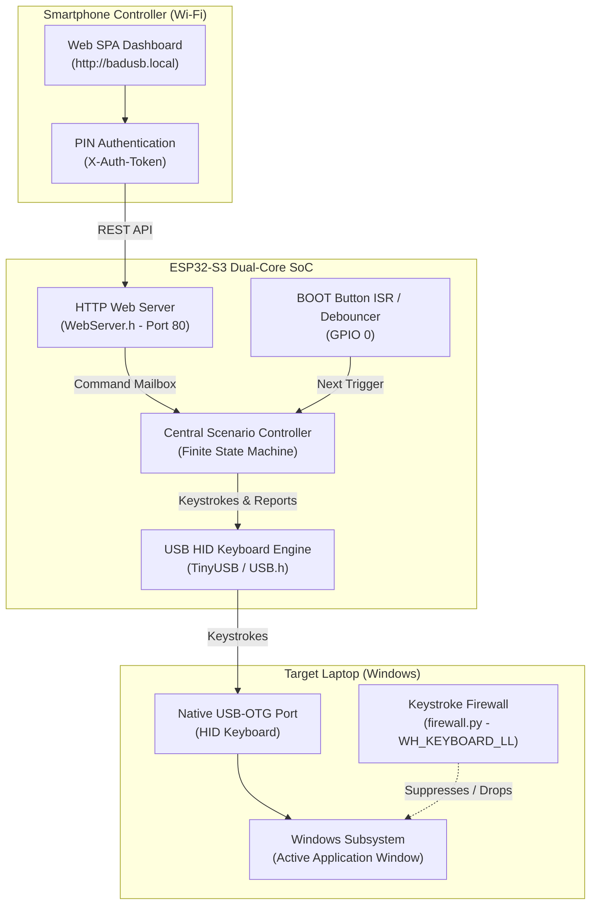
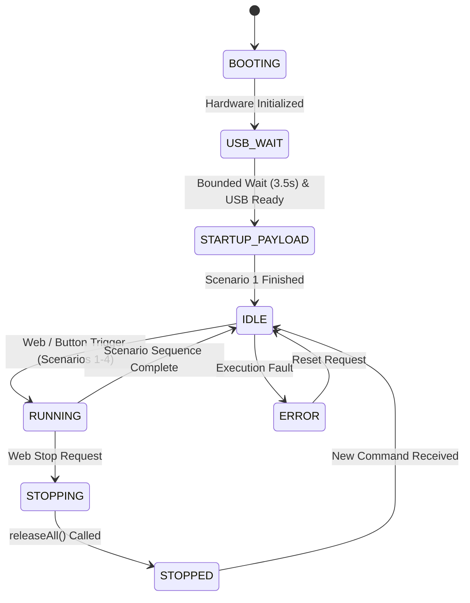
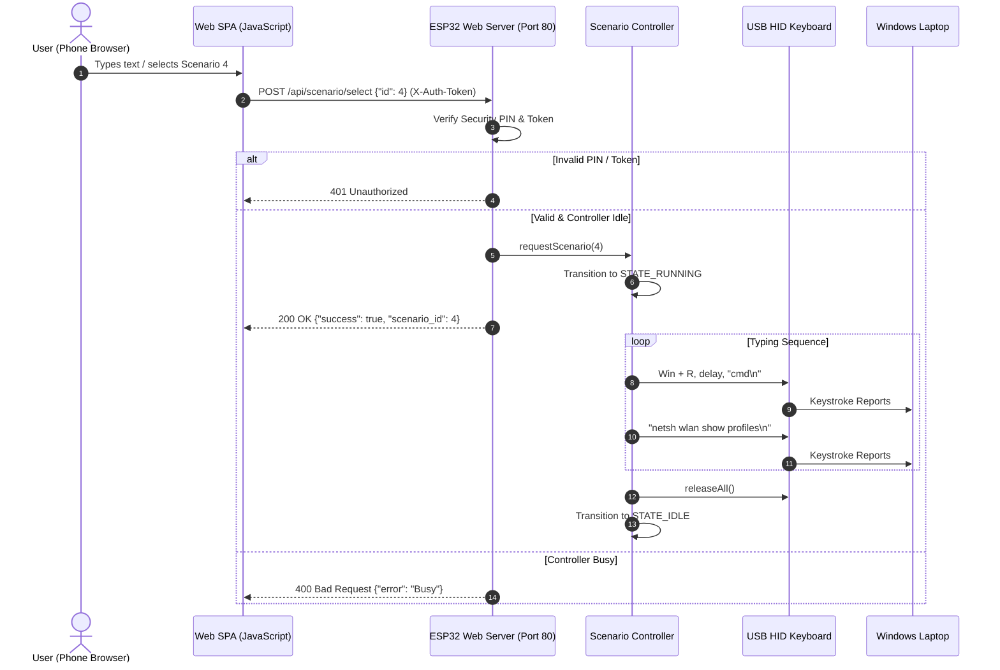

# System Architecture: ESP32-S3 BadUSB Remote Control Platform

## 1. System Overview

The **ESP32-S3 BadUSB Remote Control Platform** is an integrated hardware and software environment for demonstrating USB HID keystroke injection and host-side defense. It comprises three interacting layers:

1. **Smartphone Web Controller**: An authenticated web application served from ESP32 flash (`PROGMEM`), accessible via Wi-Fi.
2. **ESP32-S3 Embedded Controller**: Coordinates Wi-Fi connectivity, command authentication, scenario sequencing, and native USB HID emulation.
3. **Host Computer (Windows)**: Receives USB HID keyboard events in active applications and runs the Python keystroke suppression firewall.

---

## 2. Firmware Subsystems

### 2.1 Native USB HID Keyboard Subsystem
The ESP32-S3 features an on-chip USB 2.0 Full Speed (12 Mbps) OTG peripheral connected directly to GPIO 19 (`D-`) and GPIO 20 (`D+`). In this architecture:
- **Descriptor Configuration**: Configured with Manufacturer `"TinyUSB"` and Product `"BadUSB Demo"`.
- **Operating Stack**: Utilizes the native Arduino ESP32 TinyUSB wrapper (`USBHIDKeyboard.h` and `USB.h`).
- **Endpoint Structure**: Configured as a composite HID device providing a standard 8-byte boot keyboard report (1 byte modifier mask, 1 byte reserved, 6 keycode slots).
- **Safe Release Invariant**: Every character or special key event is automatically followed by an inter-key delay and a full `releaseAll()` call, ensuring no modifier or alphanumeric keys remain stuck if communication drops.

### 2.2 Wi-Fi & Local Web Server Subsystem
- **Dual Mode (`WIFI_AP_STA`)**:
  - **SoftAP**: Operates on channel 1 with SSID `BadUSB-Controller` and WPA2 passphrase `badusb_control`, binding to `192.168.4.1`.
  - **Station Mode**: Connects as a client to the smartphone's personal hotspot (e.g. `Galaxy`), allowing the phone and laptop to share the same local subnet without disconnecting the phone from cellular data.
- **mDNS Service**: Resolves `http://badusb.local` to the device's IP automatically.
- **Single-Page Application (SPA)**: Stored in PROGMEM flash memory, eliminating external SD card or SPIFFS filesystem dependencies.

---

## 3. Scenario Controller State Machine

The central scenario controller manages scenario lifecycle, hardware button triggers, and phone requests through a formal Finite State Machine (FSM):

### State Descriptions
1. **`BOOTING`**: Initializes GPIO 0, serial debugging, and USB HID stack.
2. **`USB_WAIT`**: Bounded wait state ensuring host USB enumeration completes before typing starts.
3. **`STARTUP_PAYLOAD`**: Automatically executes Scenario 1 once. Guarantees that the device works out-of-the-box even without a Wi-Fi connection.
4. **`IDLE`**: Awaits either physical BOOT button presses or authenticated HTTP API requests.
5. **`RUNNING`**: Actively injecting keystrokes according to the chosen scenario sequence. Rejects concurrent start requests to prevent overlapping transmissions.
6. **`STOPPING`**: Set immediately when the user clicks **Stop** in the web interface. Aborts typing loops and invokes `Keyboard.releaseAll()`.
7. **`STOPPED`**: Safe resting state following an abort. Clears any pending queue actions.

---

## 4. Phone-to-Device Command Flow

---

## 5. Host-Side Keystroke Firewall & Dynamics Defense

The defense architecture ([`src/firewall.py`](file:///c:/Users/Ram/Desktop/BadUSB_Using_ESP32/src/firewall.py), [`src/detection/`](file:///c:/Users/Ram/Desktop/BadUSB_Using_ESP32/src/detection/)) provides an advanced host-side mitigation model combining behavioral biometrics and hardware-level per-device attribution:

### 5.1 Per-Device Attribution via Windows Raw Input (`WM_INPUT`)
Traditional global hooks cannot differentiate between a legitimate internal keyboard and a rogue USB HID dongle. WHID-Guard addresses this via the Win32 Raw Input API:
1. **Raw Input Sink (`RIDEV_INPUTSINK`)**: The host defense initializes a message-only background window and registers for raw keyboard devices via `RegisterRawInputDevices`.
2. **Device Handle Query (`GetRawInputDeviceInfoW`)**: On receipt of `WM_INPUT`, the driver extracts `hDevice`, queries `RIDI_DEVICENAME`, and parses the USB Vendor ID and Product ID:
   - ESP32-S3 Hardware HID: `VID: 0x303A, PID: 0x1001`
   - Internal Laptop Keyboard: `ACPI\PNP0303` / `ATK3001`
3. **Selective Event Suppression**: The low-level keyboard hook (`WH_KEYBOARD_LL`) queries the active `hDevice` from the Raw Input sink. If the dynamics engine flags an anomaly, only keystrokes originating from the offending `hDevice` are dropped (`return 1`). Legitimate peripherals remain completely unhindered.

### 5.2 Real-Time Behavioral Keystroke Dynamics Engine
Keystrokes are evaluated in an online sliding window of $W = 10$ events:
- **Inter-Key Interval (IKI)**: $\Delta t_i = t_{i+1} - t_i$
- **Mean IKI**: $\mu_{\text{IKI}} = \frac{1}{W-1} \sum \Delta t_i$
- **Standard Deviation**: $\sigma_{\text{IKI}} = \sqrt{\frac{1}{W-2} \sum (\Delta t_i - \mu_{\text{IKI}})^2}$
- **Coefficient of Variation**: $CV = \frac{\sigma_{\text{IKI}}}{\mu_{\text{IKI}}}$
- **Burst Rate**: $R_{\text{burst}} = \frac{1}{\mu_{\text{IKI}}}$ (characters per second)

#### Decision Rule:
- **`LOCKED_DOWN` (BadUSB Machine Injection)**: Triggered when $\mu_{\text{IKI}} < 25\text{ ms}$ or $CV < 0.15$ over 8 consecutive events. The offending `hDevice` is tagged and quarantined within $<85\text{ ms}$ ($\le 8\text{ characters}$).
- **`SAFE` (Human Operator)**: Satisfied when $\mu_{\text{IKI}} > 75\text{ ms}$ and $CV > 0.30$.
- **`SUSPICIOUS` (Adversarial Cadence Emulation)**: Flagged when artificial jitter elevates mean IKI but lacks human neuromuscular digram variance.

### 5.3 Safety Watchdog & Failsafes
- Background watchdog timer (default 15 seconds) automatically disarms suppression if an unexpected lock occurs.
- `atexit.register(self.disable)` and Tkinter `WM_DELETE_WINDOW` ensure hooks are released upon application termination.

---

## 6. Adversarial Evasion & Resilience

To test defensive resilience against adaptive attackers, the ESP32-S3 firmware provides an adversarial stealth mode:
- **Stochastic Delays**: Emulates human typing latency via randomized inter-character timing:
  $$\Delta t = \text{baseDelayMs} + \text{random}(0, \text{jitterRangeMs})$$
- **Cognitive Micro-Pauses**: Automatically inserts $150\text{--}300\text{ ms}$ pauses after punctuation, spaces, and linebreaks.
- **REST Control**: Configurable remotely via `POST /api/settings/stealth`.
