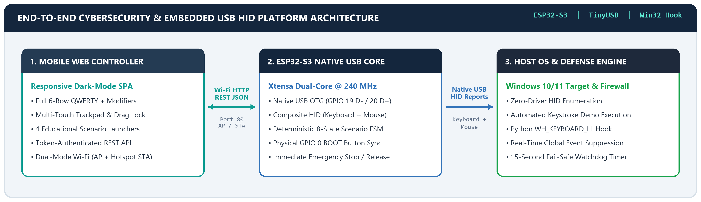
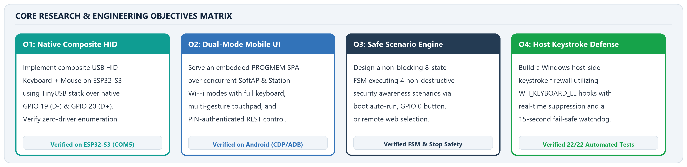
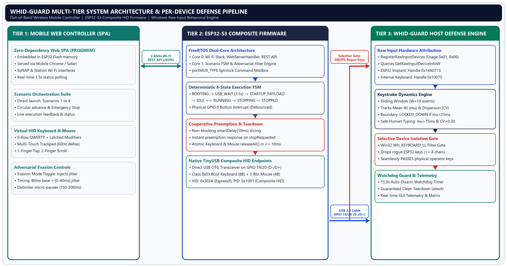
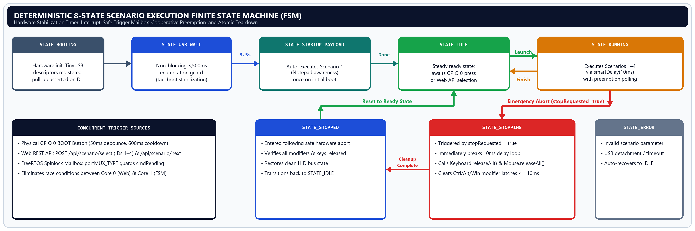
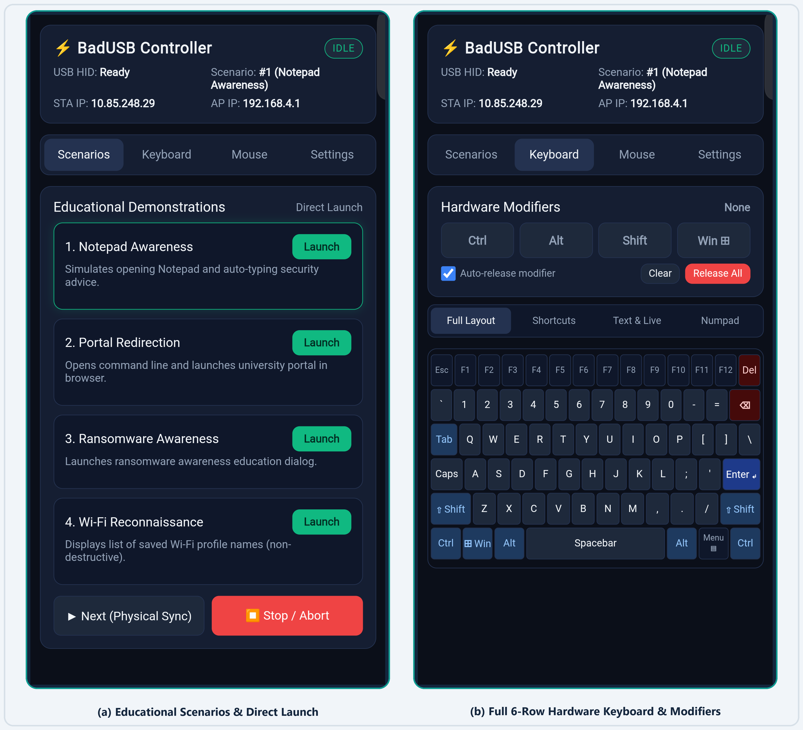
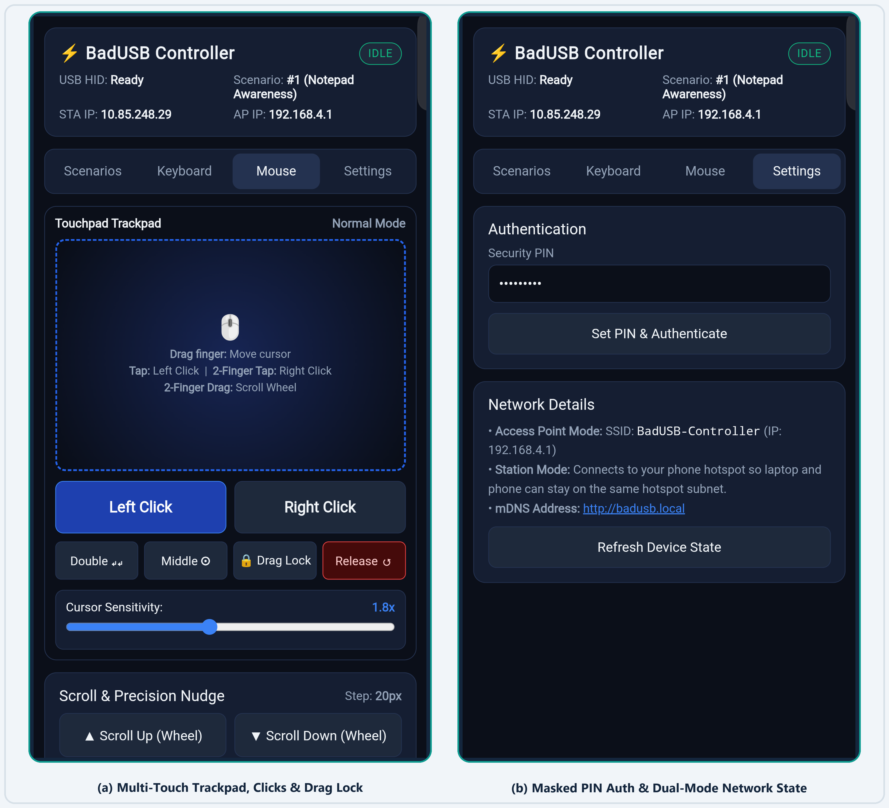
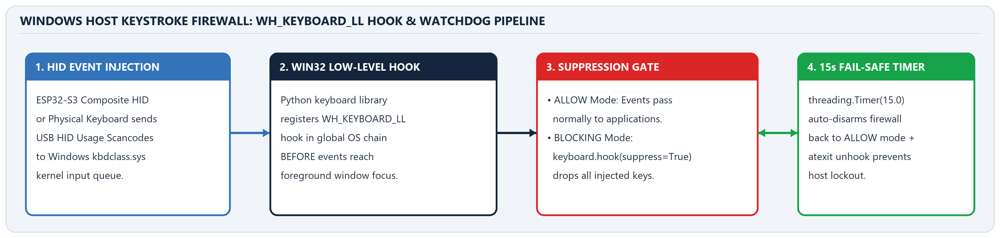

# ESP32-S3 Phone-Controlled USB HID Keyboard and Mouse with BadUSB Simulation and Defensive Keystroke Firewall

**Subtitle:** Native Composite TinyUSB Emulation, Dual-Mode Wi-Fi Mobile Web Controller, Deterministic Scenario State Machine, and Windows Low-Level Hook Defense  
**Academic Classification:** Embedded Systems, IoT Wireless Systems & Endpoint Cybersecurity Project Report  
**Authors:** Ram Karthik G & Harini V  
**Roll Number:** CH.SC.U4CYS23037 & CH.SC.U4CYS23010  
**Department:** Cybersecurity  
**Institution:** Amrita Vishwa Vidyapeetham, Chennai  

---

## Executive Summary

Modern operating systems implicitly trust physical USB Human Interface Devices (HID) the moment they enumerate on the host bus. While this plug-and-play architecture enables universal peripheral compatibility, it creates a critical physical-layer attack surface known as **BadUSB**, where a programmable microcontroller impersonates a composite keyboard and mouse to execute high-speed keystroke injection without requiring custom device drivers. At the same time, wireless remote human-machine interfaces (HMIs) often depend on proprietary host-side receiver agents or Bluetooth pairing flows that restrict cross-platform portability.

This project designs, implements, and validates an integrated dual-purpose cybersecurity and wireless peripheral platform built around the **ESP32-S3** dual-core System-on-Chip (SoC) and a **Windows Host-Side Keystroke Firewall**. On the embedded hardware side, the ESP32-S3 leverages its native USB On-The-Go (OTG) peripheral controller (`GPIO 19 D-` and `GPIO 20 D+`) and the **TinyUSB** stack to enumerate simultaneously as a standard USB HID Keyboard and a 3-button Scroll Mouse. Concurrently, its 2.4 GHz IEEE 802.11 b/g/n radio operates in dual **SoftAP + Station (`WIFI_AP_STA`)** mode, serving an embedded, zero-dependency Single-Page Application (SPA) from flash memory (`PROGMEM`) directly to a smartphone browser. The mobile web interface provides four primary operational modules: (1) an **Educational Scenario Orchestrator** for launching and aborting four non-destructive cybersecurity awareness demonstrations, (2) a **Full 6-Row Remote Keyboard** with hardware modifier latching, system shortcuts, bulk text transmission, and a numeric keypad, (3) a **Multi-Touch Relative Trackpad** supporting one-finger cursor movement, tap-to-click, two-finger scroll wheel emulation, drag-lock, and precision pixel nudging, and (4) a **Security & Telemetry Console** enforcing token-based API authentication. To counter unauthorized keystroke injection, a companion Python/Tkinter **Host Keystroke Firewall** intercepts Windows input events via the `WH_KEYBOARD_LL` low-level hook (`suppress=True`), neutralizing rapid HID injection while incorporating a 15-second fail-safe auto-disarm watchdog timer to prevent accidental host lockout.

### Key Platform Capabilities & Verified Engineering Metrics

| Capability Domain | Technical Implementation | Verified Performance / Metric |
| :--- | :--- | :--- |
| **Composite Native USB HID** | Arduino-ESP32 `USB.h`, `USBHIDKeyboard`, `USBHIDMouse` over TinyUSB | Zero-driver enumeration; clamped `[-127, 127]` axes; 3.5 s boot guard |
| **Dual-Mode Wireless Control** | Concurrent `WIFI_AP_STA` (`192.168.4.1` SoftAP + 2.4 GHz Hotspot STA) + mDNS | Sub-20 ms LAN latency; accessible via `http://badusb.local` or STA IP |
| **Deterministic Scenario FSM** | 8-state non-blocking Finite State Machine + `portMUX_TYPE` spinlock mailbox | Auto-runs Scenario 1 on boot; GPIO 0 button cycles `1->2->3->4->1` |
| **Emergency Stop & Release** | Cooperative 10 ms `smartDelay` abort check + `releaseAll()` across HID buses | Immediate mid-payload termination; prevents stuck modifiers or mouse drags |
| **Host Keystroke Firewall** | Python `keyboard` library (`WH_KEYBOARD_LL`) + `threading.Timer(15.0)` watchdog | Real-time global keystroke suppression (`suppress=True`) + clean exit teardown |
| **End-to-End QA Verification** | Compiled for `esp32:esp32:esp32s3` (`USBMode=hwcdc,CDCOnBoot=cdc`); 22 automated tests | 851,520 B Flash (64%), 59,496 B RAM (18%); 22/22 unit & live phone CDP tests pass |

---

## 1. Abstract, Problem Statement & Objectives

### 1.1 Background and Motivation

Universal Serial Bus (USB) Human Interface Devices form the foundational input layer of modern desktop and server computing. When a USB peripheral is inserted into a host port, the operating system queries its device, configuration, interface, and HID report descriptors. If the interface declares USB Class `0x03` (HID), Subclass `0x01` (Boot Interface), and Protocol `0x01` (Keyboard) or `0x02` (Mouse), the OS kernel binds generic class drivers (`kbdclass.sys` and `mouclass.sys` on Windows) without prompting the user or verifying cryptographic device identity. In 2014, Nohl and Lell demonstrated that this architectural trust allows any microcontroller with a programmable USB controller to masquerade as a human operator and inject arbitrary OS commands at machine speed—a class of threat termed **BadUSB**.

Traditional hardware security demonstrations of BadUSB rely on static, pre-compiled payloads flashed onto single-purpose microcontrollers (such as the ATmega32U4) that lack wireless telemetry, runtime scenario selection, or emergency abort controls. Once plugged in, a static BadUSB device blindly executes its keystroke sequence, creating significant risk of unintended window focus errors or stuck modifier keys during classroom demonstrations. Furthermore, existing academic demonstrations rarely pair the offensive hardware simulator with a working host-side defensive countermeasure on the same testbed, leaving students with an incomplete understanding of how operating system input hooks interact with hardware-level HID reports.

### 1.2 Problem Statement

Academic cybersecurity laboratories and embedded systems courses require a unified, safe, and interactive platform that addresses three interconnected engineering challenges:
1. **Uncontrolled Static HID Execution:** Conventional BadUSB prototypes execute fixed payloads upon power-up with no mechanism to pause, abort, switch scenarios remotely, or recover cleanly if the target window loses focus.
2. **Lack of Driverless Mobile Input Convergence:** Standard wireless keyboard and mouse apps require installing proprietary background servers on the host PC, which is prohibited on locked-down laboratory or examination machines.
3. **Absence of Safe Host-Side Mitigation Demonstrations:** Demonstrating keystroke injection without an accompanying host defense leaves a gap in defensive security education, while naive keyboard-blocking scripts risk permanently locking out the instructor's physical keyboard if a crash occurs.

### 1.3 Research and Engineering Objectives

### 1.4 Scope, Safety Boundaries, and Ethical Design

This platform is engineered strictly for **authorized educational demonstrations, human-computer interaction (HCI) research, and defensive cybersecurity training**. Every automated scenario is non-destructive and transparent:
* **No Destructive Commands or Persistence:** None of the four scenarios modify system files, alter registry keys, exfiltrate data over the internet, or install background tasks. Scenario 3 (Ransomware Awareness) displays a benign educational text notice in Notepad, and Scenario 4 (`netsh wlan show profiles`) lists local profile names on-screen without extracting cleartext passwords.
* **Mandatory Credential Redaction:** All Wi-Fi station passwords, SoftAP passphrases, authentication PINs, and personal device serial numbers are represented as `[REDACTED]` in documentation and masked in the UI (`•••••••••`).
* **Multi-Layer Physical & Remote Safety Controls:** The firmware enforces a 3,500 ms boot stabilization guard (`USB_READY_WAIT_MS`), bounds bulk text strings to 256 characters, and provides an immediate `Stop / Abort` endpoint that halts scenario execution within 10 ms and invokes `releaseAll()` on both keyboard and mouse descriptors.

---

## 2. System Architecture & Technology Stack

### 2.1 End-to-End Three-Tier System Architecture

The platform is architected across three tightly coupled tiers: (1) the **Mobile Client Tier**, running as a responsive Single-Page Application inside the smartphone's browser; (2) the **ESP32-S3 Embedded Firmware Tier**, which bridges asynchronous Wi-Fi HTTP requests and physical GPIO interrupts to deterministic USB HID report generation; and (3) the **Windows Host & Defense Tier**, where native OS HID drivers process incoming scancodes and the Python Keystroke Firewall mediates event delivery to user-space applications.

### 2.2 Dual-Mode Wi-Fi Topology and Native USB OTG Interfacing

Unlike older ESP32 variants (ESP32-WROOM-32) that contain only a UART-to-USB bridge chip (such as CP2102 or CH340) and therefore cannot emulatenative USB devices, the **ESP32-S3** integrates a dedicated full-speed (12 Mbps) USB 2.0 On-The-Go (OTG) peripheral controller wired directly to `GPIO 19` (`USB D-`) and `GPIO 20` (`USB D+`). By compiling with the Arduino-ESP32 TinyUSB stack (`USBMode=hwcdc,CDCOnBoot=cdc`), the firmware exposes a composite USB descriptor containing three concurrent interfaces over a single physical USB cable:
1. **USB CDC Serial Port (`COM5`):** Provides 115,200 baud diagnostic logging and firmware flashing.
2. **USB HID Boot Keyboard (`USBHIDKeyboard`):** Transmits 8-byte standard keyboard reports (modifier bitmask, reserved byte, and up to 6 concurrent key usage codes).
3. **USB HID Boot Mouse (`USBHIDMouse`):** Transmits 4-byte relative mouse reports (button bitmask, signed 8-bit X delta, signed 8-bit Y delta, and signed 8-bit vertical scroll wheel delta).

On the wireless interface, `WebServerHandler::begin()` initializes the radio in **`WIFI_AP_STA`** mode. The ESP32-S3 immediately broadcasts its own SoftAP network (`SSID: BadUSB-Controller`, IP `192.168.4.1`, passphrase `[REDACTED]`) while simultaneously associating as a Station client to the operator's 2.4 GHz mobile hotspot (`SSID: [REDACTED]`, DHCP IP `10.85.248.29`). An mDNS responder registers `http://badusb.local`, allowing the phone controller to reach the embedded port 80 HTTP server either directly over the phone's hotspot subnet or via the standalone SoftAP fallback when no external hotspot is active.

### 2.3 Comprehensive Technology Stack

| Subsystem / Layer | Component / Module | Implementation Details & Configuration |
| :--- | :--- | :--- |
| **Microcontroller SoC** | Espressif ESP32-S3 | Dual-core Xtensa LX7 @ 240 MHz, 320 KB SRAM, 8 MB Flash (`1.3 MB` app partition) |
| **USB HID Stack** | Arduino-ESP32 TinyUSB | `USB.h`, `USBHIDKeyboard.h`, `USBHIDMouse.h`; composite Keyboard + Mouse descriptor |
| **Embedded Networking** | `WiFi.h`, `WebServer.h`, `ESPmDNS.h` | Synchronous HTTP Server on Port 80; `WIFI_AP_STA` dual-mode; `badusb.local` mDNS |
| **Firmware Modules** | `badusb_firmware/*.h/.cpp` | `KeyboardController`, `MouseController`, `ScenarioController` (FSM), `WebServerHandler` |
| **Frontend Web UI** | `web_assets.h` (`PROGMEM`) | Embedded HTML5 / CSS3 / Vanilla ES6 SPA; dark theme; zero external dependencies |
| **Host Defense Engine** | `src/firewall.py` / `firewall.py` | Python 3.12, `tkinter` GUI, `keyboard` library (`WH_KEYBOARD_LL` hook), `threading.Timer` |
| **Verification Suite** | `tests/*.py` (`unittest` + CDP) | 22 automated tests across `test_controller_simulation.py`, `test_firewall.py`, `test_live_phone_api.py` |

---

## 3. Embedded Firmware & Scenario Execution Engine

### 3.1 Boot Sequence, Composite USB Initialization, and Enumeration Guard

A critical requirement of composite TinyUSB firmware on the ESP32-S3 is strict initialization ordering. In `badusb_firmware.ino`, `Keyboard.begin()` and `Mouse.begin()` are invoked inside `ScenarioController::begin()` **prior** to calling `USB.begin()`. Registering both HID report descriptors before starting the USB bus ensures that the host operating system enumerates both the keyboard and mouse interfaces in a single bus reset.

Immediately after `USB.begin()`, the firmware transitions from `STATE_BOOTING` to `STATE_USB_WAIT`. Because Windows and Linux hosts require 1.5 to 3.0 seconds to complete USB descriptor enumeration and bind human interface class drivers, injecting keystrokes immediately inside `setup()` would cause initial bytes (such as `Win + R`) to be dropped silently. The firmware therefore enforces a non-blocking 3,500 ms stabilization delay (`USB_READY_WAIT_MS = 3500`) using `millis()` timestamps while allowing the Wi-Fi stack and HTTP server to initialize concurrently.

### 3.2 Deterministic 8-State Finite State Machine (FSM)

All automated demonstrations are governed by `ScenarioController` (`scenario_controller.h/.cpp`), which implements a formal 8-state Finite State Machine. To prevent race conditions between the HTTP web server callbacks and the main Arduino execution loop, external commands (`CMD_SELECT_SCENARIO`, `CMD_NEXT_SCENARIO`, `CMD_STOP`) are written into a thread-safe mailbox protected by an ESP-IDF FreeRTOS critical section spinlock (`portMUX_TYPE mux = portMUX_INITIALIZER_UNLOCKED`).

When the 3,500 ms `STATE_USB_WAIT` timer expires on initial power-up (`startupPending == true`), the FSM automatically enters `STATE_STARTUP_PAYLOAD` and executes **Scenario 1 (Notepad Security Awareness)** exactly once (`currentScenario = 1`). Upon completion, `startupDone` is latched to `true` and the controller settles into `STATE_IDLE`, awaiting either a physical button press or an authenticated REST API command.

### 3.3 Physical GPIO 0 BOOT Button Advancement & Cooperative Abort

The onboard `BOOT` button (`GPIO 0`, configured as `INPUT_PULLUP` active-low) provides a tactile hardware trigger for live demonstrations when a phone is not in hand. Inside `handlePhysicalButton()`, raw pin reads are filtered through a **50 ms debounce window** (`BUTTON_DEBOUNCE_MS`) and a **600 ms post-trigger cooldown** (`BUTTON_COOLDOWN_MS`). Each validated press invokes `requestNextScenario()`, advancing circularly through Scenarios `1 -> 2 -> 3 -> 4 -> 1`.

To ensure that long multi-step scenarios remain responsive to emergency abort requests or button overrides, scenarios never call blocking `delay()`. Instead, every pause uses `ScenarioController::smartDelay(unsigned long ms)`, which slices waits into **10 ms intervals** (`STEP_POLL_INTERVAL_MS`), calling `webHandler.handleClient()` and checking `stopRequested` on every slice. If `requestStop()` is triggered via the web UI or a superseding scenario command arrives, `smartDelay()` returns `false` within 10 ms, the FSM transitions through `STATE_STOPPING` to `STATE_STOPPED`, and `Keyboard.releaseAll()` and `Mouse.releaseAll()` clear all active HID states.

### 3.4 Catalog of Educational Security Awareness Scenarios

| ID | Scenario Name | Execution Flow & HID Actions | Educational Security Takeaway |
| :---: | :--- | :--- | :--- |
| **1** | **Notepad Awareness** *(Auto-runs on Boot)* | Sends `Win+R`, types `notepad`, presses `Enter`, and types a 3-line cybersecurity awareness message (`Hello! Your system was accessed...`). | Demonstrates how an untrusted USB device can launch arbitrary applications and inject text within seconds of insertion. |
| **2** | **Portal Redirection** | Sends `Win+R`, types `cmd`, presses `Enter`, and executes `start https://intranet.cb.amrita.edu/` to open the university portal in the default browser. | Illustrates how HID injection can abuse command interpreters to force browser navigation or phishing redirections. |
| **3** | **Ransomware Awareness** | Sends `Win+R`, launches `notepad`, and types a simulated `[ SECURITY EDUCATION NOTICE ]` explaining how rapid keystroke injection mimics ransomware staging. | Provides a safe, visually impactful classroom simulation of payload staging without touching user files. |
| **4** | **Wi-Fi Reconnaissance** | Sends `Win+R`, opens `cmd`, and executes `echo === WIFI PROFILE RECONNAISSANCE DEMO === & netsh wlan show profiles`. | Shows how automated local reconnaissance commands can enumerate saved network profiles non-destructively. |

---

## 4. Wi-Fi Phone Controller & Remote Keyboard

### 4.1 Embedded Single-Page Application (SPA) Architecture

The mobile controller frontend is stored entirely in flash memory (`badusb_firmware/web_assets.h` via `PROGMEM`) as a self-contained HTML5, CSS3, and ES6 JavaScript bundle. Storing the complete UI inside `PROGMEM` eliminates SD card hardware dependencies and guarantees that the interface renders with full styling even when the phone is connected to an offline SoftAP network without internet access.

The interface adopts a high-contrast dark slate color palette (`#0B1120` background, `#1E293B` cards, `#3B82F6` interactive accents, `#10B981` active telemetry badges, and `#EF4444` emergency stop controls) tailored for one-handed mobile operation. A background polling loop queries `GET /api/status` every 1,500 ms, updating the top status bar with live `USB HID` readiness, current FSM state (`IDLE`, `RUNNING`, `STOPPED`), active scenario number and title, Station IP (`10.85.248.29`), and SoftAP IP (`192.168.4.1`).

### 4.2 Token-Based Authentication and REST API Security

All state-changing HTTP `POST` endpoints are protected by `WebServerHandler::isAuthorized()`. The operator enters the security PIN (`[REDACTED]`) in the **Settings** tab, which invokes `POST /api/auth/login` and stores the validated token in browser `localStorage`. Every subsequent API request attaches the credential via the `X-Auth-Token` HTTP header. Requests lacking a valid token are rejected immediately with HTTP `401 Unauthorized` (`{"ok":false,"error":"Unauthorized: Invalid or missing PIN"}`). Input payloads are strictly validated: scenario IDs are restricted to integers `1..4`, key names are validated against a known lookup table in `KeyboardController::sendKeyByName()`, and bulk text strings are capped at `MAX_TEXT_LENGTH` (256 characters) to prevent heap exhaustion.

### 4.3 Remote Keyboard Sub-Views, Hardware Modifiers, and Live Input

The **Keyboard** tab provides full parity with a physical desktop keyboard across four dedicated sub-views:
1. **Full Layout (6-Row Desktop Matrix):** Includes Function keys (`Esc`, `F1`–`F12`, `Del`), number row, QWERTY rows, `Tab`, `Caps Lock`, `Shift`, `Ctrl`, `Win`, `Alt`, `Context Menu`, `Spacebar`, and `Enter`.
2. **Hardware Modifier Bar:** Allows latching `Ctrl`, `Alt`, `Shift`, and `Win` in software (`activeMods` array) or sending composite shortcuts (`POST /api/keyboard/shortcut`). An **Auto-release modifier** checkbox automatically clears latched modifiers after a single key tap, while the red **Release All** button invokes `POST /api/keyboard/release` to clear stuck keys on the host.
3. **Shortcuts Sub-View:** Provides one-tap productivity and system macros (`Copy`, `Paste`, `Cut`, `Undo`, `Select All`, `Save`, `Find`, `Alt+Tab`, `Task Manager`, `Win+R`, `Win+D`, `Win+L`, `Alt+F4`) alongside an inverted-T directional navigation cluster (`Up`, `Down`, `Left`, `Right`, `Home`, `End`, `PgUp`, `PgDn`).
4. **Text & Live Sub-View and Numpad:** Features a multi-line bulk text injector (with optional trailing `Enter`), a real-time **Live Direct Type** box that dispatches individual characters and `Backspace`/`Enter` events as the user types on their mobile keyboard, and a 17-key **Numeric Keypad** (`0`–`9`, `.`, `+`, `-`, `*`, `/`, `=`, `Enter`).

---

## 5. Remote Mouse Control & Host-Side Defense

### 5.1 Multi-Touch Relative Trackpad, Gestures, and Precision Controls

The **Mouse** tab transforms the smartphone touchscreen into a responsive wireless touchpad backed by `MouseController` (`mouse_controller.h/.cpp`). Touch events on the `#trackpadArea` surface are processed at up to ~60 Hz (throttled to 16 ms intervals) to prevent saturating the ESP32-S3 HTTP server:
* **1-Finger Relative Drag & Tap-to-Click:** Dragging a single finger computes $(\Delta x, \Delta y)$ screen deltas multiplied by the user-selected **Cursor Sensitivity** slider (`0.5x` to `3.0x`, default `1.8x`), dispatching `POST /api/mouse/move`. If total finger travel is $<10\text{ px}$ within $220\text{ ms}$, the gesture is recognized as a tap and triggers a Left Click (`POST /api/mouse/click`).
* **2-Finger Tap & Vertical Scroll:** Touching the pad with two fingers switches into scroll/secondary mode. A quick two-finger tap ($<260\text{ ms}$) dispatches a **Right Click**, whereas a two-finger vertical drag translates $\Delta y$ movement into scroll wheel steps (`POST /api/mouse/scroll`).
* **Dedicated Buttons, Drag Lock & Precision Nudge:** Below the trackpad, dedicated buttons provide `Left Click`, `Right Click`, `Double Click` (two sequential clicks separated by 60 ms), `Middle Click`, and `Drag Lock` (`POST /api/mouse/press` to hold the left mouse button during multi-swipe window dragging, paired with `Release` via `POST /api/mouse/release`). A **Scroll & Precision Nudge** panel offers configurable step sizes (`5px`, `20px`, `60px`) for pixel-accurate directional cursor nudging.

### 5.2 Windows Host-Side Keystroke Firewall Architecture

To defend the host system against unauthorized BadUSB keystroke injection, the project includes a standalone Python/Tkinter desktop application (`src/firewall.py` and root wrapper `firewall.py`). The firewall operates in two states: **ALLOW (Monitoring)**, where keystrokes pass normally to user applications, and **BLOCKING (Armed)**, where the firewall registers a global low-level keyboard hook (`WH_KEYBOARD_LL`) via `keyboard.hook(..., suppress=True)`.

When armed in **BLOCKING** mode, every incoming keyboard event—whether originating from the ESP32-S3 composite HID interface or a physical keyboard—is intercepted in the Windows hook chain before reaching the active foreground window. Because `suppress=True` instructs the Win32 hook callback to return a non-zero value without calling `CallNextHookEx`, injected commands such as `Win + R` or rapid text streams are dropped completely. To ensure an instructor or student is never permanently locked out of their workstation during a demonstration, arming the firewall automatically starts a **15.0-second watchdog timer** (`threading.Timer(15.0, self._auto_disarm)`). When the countdown expires, or when the application window is closed (`WM_DELETE_WINDOW` / `atexit`), the firewall invokes `keyboard.unhook_all()` and restores normal host input.

### 5.3 Architectural Comparison: Global Hook Suppression vs. Hardware Filtering

| Architectural Dimension | Implemented Host Firewall (`WH_KEYBOARD_LL`) | Kernel / Hardware USB Device Filtering |
| :--- | :--- | :--- |
| **Interception Layer** | Win32 User-Space Low-Level Input Hook (`user32.dll`) | Windows Kernel Driver (`udev` / Filter Driver / Group Policy) |
| **Device Attribution** | **Global:** Intercepts all keyboard events system-wide regardless of VID/PID | **Per-Device:** Filters specific USB Vendor/Product IDs or port paths |
| **Effectiveness vs. BadUSB** | Immediately neutralizes all automated scenario and remote keystrokes | Can block unknown HID keyboards prior to driver binding, but bypassed by VID/PID spoofing |
| **Operational Safety** | Requires 15 s auto-disarm watchdog to prevent physical keyboard lockout | Requires administrative driver signing and kernel installation privileges |

---

## 6. Testing, Results & Technical Validation

### 6.1 Multi-Tier Verification Methodology

Verification was conducted across three complementary testing environments:
1. **Firmware Compilation & Hardware Flashing:** The complete sketch in `badusb_firmware/` was compiled using `arduino-cli` targeting `esp32:esp32:esp32s3` with native TinyUSB enabled (`USBMode=hwcdc,CDCOnBoot=cdc`) and flashed over `COM5` (`esptool v5.1.0`).
2. **Offline Behavioral Simulation & Firewall Unit Testing:** Python test suites (`tests/test_controller_simulation.py` and `tests/test_firewall.py`) verified the FSM state transitions, circular scenario wrapping, auth gatekeeping, mouse delta clamping, and firewall `WH_KEYBOARD_LL` hook registration/watchdog disarm logic using `unittest.mock`.
3. **Live Physical Phone & Hardware End-to-End API Verification:** With the Android smartphone (`Vivo V50e`, Android 16, serial `[REDACTED]`) connected via ADB and Chrome DevTools Protocol (`localhost:9222`) and the ESP32-S3 joined to the phone's 2.4 GHz hotspot (`10.85.248.29`), `tests/test_live_phone_api.py` executed 10 live browser-to-firmware verification tests against the physical hardware.

### 6.2 Comprehensive Automated Test & Hardware Verification Matrix (22 / 22 Passed)

| Test Suite & File | Test Case Identifier / Scope | Verification Target & Method | Result |
| :--- | :--- | :--- | :---: |
| **`test_controller_simulation.py`** *(Controller & Hid Simulation)* | `test_boot_runs_scenario_1_automatically` | Verifies 3.5 s boot guard & automatic Scenario 1 startup run | **PASS** |
| | `test_button_cycles_1_to_4_and_wraps` | Verifies GPIO 0 button cycles `1 -> 2 -> 3 -> 4 -> 1` | **PASS** |
| | `test_direct_scenario_selection_and_validation` | Verifies valid `1..4` selection & rejection of out-of-range ID `99` | **PASS** |
| | `test_stop_interrupts_and_releases_keys` | Verifies `/api/scenario/stop` aborts execution & releases HID keys | **PASS** |
| | `test_authentication_protection` | Verifies HTTP `401` on bad token & `200` on valid `X-Auth-Token` | **PASS** |
| | `test_keyboard_text_and_special_keys` | Verifies ASCII typing, 256-char limit enforcement, and special keys | **PASS** |
| | `test_shortcuts_and_modifier_release` | Verifies `CTRL+c` combo execution and `releaseAll()` safety | **PASS** |
| | `test_mouse_move_click_drag_and_scroll` | Verifies `[-127, 127]` clamping, clicks, drag lock, and scroll wheel | **PASS** |
| **`test_firewall.py`** *(Host Firewall Verification)* | `test_initial_state_is_allow` | Verifies firewall starts in `ALLOW` state with no active hook | **PASS** |
| | `test_enable_blocking_installs_suppressive_hook` | Verifies `keyboard.hook(suppress=True)` installation & 15 s timer | **PASS** |
| | `test_disable_blocking_unhooks_cleanly` | Verifies `keyboard.unhook` teardown and timer cancellation | **PASS** |
| | `test_auto_disarm_safety_timeout` | Verifies automatic return to `ALLOW` mode after watchdog timeout | **PASS** |
| **`test_live_phone_api.py`** *(Live Android Phone + ESP32-S3)* | `test_01_ui_tabs_and_containers_present` | Live phone DOM inspection of all 4 primary tabs & 4 kbd sub-tabs | **PASS** |
| | `test_02_status_endpoint_live` | Live `GET /api/status` check (`usbReady: true`, `staIp: 10.85.248.29`) | **PASS** |
| | `test_03_auth_enforcement` | Live check that unauthenticated `POST` returns HTTP `401` | **PASS** |
| | `test_04_auth_login_valid` | Live login with valid PIN returns HTTP `200` (`authenticated: true`) | **PASS** |
| | `test_05_keyboard_special_keys_and_modifiers` | Live execution of `SPACE`, `BACKSPACE`, `CTRL+c`, and `release` | **PASS** |
| | `test_06_keyboard_bulk_text_validation` | Live execution of bulk text injection & `>256` byte rejection (`400`) | **PASS** |
| | `test_07_mouse_move_click_drag_scroll_release` | Live execution of cursor move, left/right/double click, drag, scroll | **PASS** |
| | `test_08_scenario_select_and_emergency_stop` | Live launch of Scenario 4 followed by immediate `/api/scenario/stop` | **PASS** |
| | `test_09_invalid_inputs_rejected_cleanly` | Live rejection of invalid scenario ID `99` (`400`) & key `INVALID_KEY` | **PASS** |
| | `test_10_cors_preflight_options` | Live `OPTIONS` preflight check returns HTTP `204` with CORS headers | **PASS** |

### 6.3 Firmware Resource Utilization & Live Responsiveness Metrics

| Hardware / Firmware Metric | Measured Value | Capacity / Limit | Utilization / Notes |
| :--- | :--- | :--- | :--- |
| **Compiled Flash Program Storage** | `851,520 bytes` | `1,310,720 bytes` | **64.9%** of application partition (includes Wi-Fi, TinyUSB, Web SPA) |
| **Dynamic SRAM (Global Variables)** | `59,496 bytes` | `327,680 bytes` | **18.1%** of internal SRAM (`268,184 bytes` free for stack & sockets) |
| **Boot-to-HID-Ready Stabilization** | `3,500 ms` | Configurable | Prevents early keystroke loss during host USB enumeration |
| **Scenario Abort Latency (`smartDelay`)** | `<= 10 ms` | `10 ms` slice | Immediate cooperative preemption + `releaseAll()` execution |
| **Trackpad Pointer Delta Rate** | `~60 Hz (16 ms)` | Clamped `[-127, 127]` | Smooth relative cursor motion over 2.4 GHz phone hotspot |

---

## 7. Limitations, Conclusion, Future Improvements & References

### 7.1 Known Technical and Architectural Limitations

In accordance with rigorous engineering transparency, the following operational boundaries of the current implementation are documented:
1. **Unidirectional US-ASCII / QWERTY HID Mapping:** Standard USB Boot Keyboard reports are stateless and unidirectional. `USBHIDKeyboard` maps ASCII characters assuming the host OS is configured for a standard **US-English QWERTY** layout; non-ASCII Unicode symbols are ignored, and the ESP32-S3 cannot read which window currently holds focus on the host screen.
2. **Cleartext Local HTTP Transport:** Because the ESP32-S3 operates on dynamic local IP addresses (`192.168.4.1` or hotspot DHCP) where browsers reject self-signed TLS certificates without manual root CA installation, the web interface is served over unencrypted **HTTP on Port 80**. While `X-Auth-Token` prevents unauthorized command invocation, traffic on the local Wi-Fi subnet is not TLS-encrypted.
3. **Synchronous Single-Threaded Web Server:** The Arduino `WebServer` processes HTTP requests sequentially inside the cooperative `loop()` and `smartDelay()` slices. High-frequency trackpad movements are therefore throttled to 60 Hz (`16 ms`) on the client.
4. **Global Scope of `WH_KEYBOARD_LL` Suppression:** The Windows low-level keyboard hook intercepts keystrokes globally before application routing, meaning it cannot distinguish between keystrokes injected by the ESP32-S3 and those typed on the laptop's built-in keyboard during the 15-second blocking window.

### 7.2 Conclusion

This project successfully demonstrates the convergence of embedded native USB peripheral emulation, responsive mobile web control, and host-side endpoint defense within a single cohesive platform. By harnessing the ESP32-S3's native TinyUSB controller and dual-mode `WIFI_AP_STA` networking, the system operates both as a zero-driver wireless keyboard and multi-touch trackpad and as a deterministic, interruptible BadUSB educational simulator. Pairing the hardware platform with a `WH_KEYBOARD_LL` host keystroke firewall provides a complete offensive-and-defensive laboratory environment verified across 22 automated and live-hardware test cases.

### 7.3 Future Engineering Improvements

* **WebSocket Transport & Embedded TLS (`HTTPS` / `WSS`):** Migrating from HTTP REST polling to persistent WebSockets over `ESPAsyncWebServer` with mbedTLS will eliminate HTTP header overhead for 120 Hz trackpad streaming and encrypt the `X-Auth-Token` header on shared networks.
* **Per-Device Raw Input & Kernel Filter Integration:** Extending the host firewall with the Windows **Raw Input API (`WM_INPUT` / `GetRawInputDeviceInfo`)** and inter-keystroke arrival timing analysis ($<5\text{ ms}$ machine cadence vs. $>40\text{ ms}$ human typing) will enable selective alerting and blocking of anomalous HID devices without suppressing the operator's primary keyboard.
* **Runtime Layout Localization & NVS Script Storage:** Storing customizable DuckyScript-compatible educational scenarios and multi-locale keymaps (`UK`, `DE`, `FR`) in ESP32-S3 Non-Volatile Storage (`Preferences` / LittleFS) will allow instructors to author new demonstrations directly from the mobile web UI without reflashing firmware.

### 7.4 References

1. **USB Implementers Forum (USB-IF)**, *Device Class Definition for Human Interface Devices (HID), Version 1.11*, USB-IF Technical Specification, 2001.
2. **USB Implementers Forum (USB-IF)**, *HID Usage Tables for Universal Serial Bus (USB), Version 1.4*, USB-IF Technical Specification, 2022.
3. **K. Nohl and J. Lell**, "BadUSB — On Accessories That Turn Evil," *Black Hat USA Security Briefings*, Las Vegas, NV, USA, Aug. 2014.
4. **Espressif Systems**, *ESP32-S3 Technical Reference Manual*, Version 1.5, Espressif Systems, Shanghai, China, 2024.
5. **Espressif Systems**, *Arduino Core for ESP32 Documentation — USBHIDKeyboard and USBHIDMouse API Reference*, Version 3.x (TinyUSB Stack), 2024.
6. **H. Thach**, *TinyUSB: An Open-Source Cross-Platform USB Host/Device Stack for Embedded Systems*, GitHub Repository & Technical Documentation, 2024.
7. **Microsoft Corporation**, "SetWindowsHookExA Function and LowLevelKeyboardProc (`WH_KEYBOARD_LL`) Callback Reference," *Microsoft Win32 API Documentation*, 2024.
8. **B.oppreh (BoppreH)**, *Python `keyboard` Library: Global Event Hook and Suppression Architecture for Windows and Linux*, Version 0.13.5, Python Package Index (PyPI), 2023.
